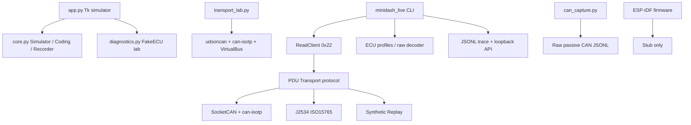
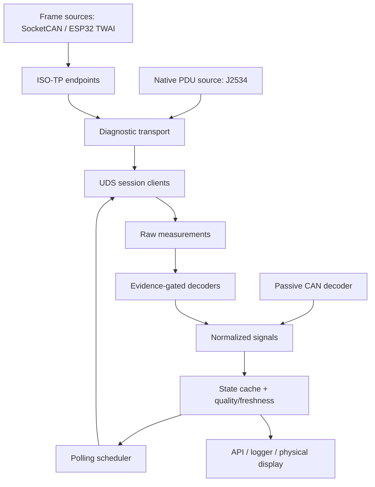

# VAG MiniDash — глубокий технический аудит

Дата аудита: 2026-09-20  
Проверенная рабочая копия: handoff v0.8 без Git metadata  
Приоритет оценки: correctness → architecture → reliability → testability → performance → style

> Historical baseline. The later feature branch has integrated session
> management, scheduler/state, discovery/identity, knowledge providers and the
> end-to-end runtime. On 2026-09-22 the exact J623 route and F405 codec were
> confirmed from real ODIS/physical traffic. Current live status and safety
> gates are authoritative in `docs/runtime/tiguan-first-live.md`.

## Executive verdict

Проект не является готовым MiniDash и пока не доказал чтение настоящего автомобиля через собственный CAN-интерфейс. Однако это уже не только GUI-макет: `minidash_live` содержит узкий read-only UDS 0x22 клиент, PDU transport abstraction, SocketCAN/can-isotp backend, общий J2534 backend, каталог реальных ECU/RDID и evidence-first JSONL trace. Это пригодное основание для эволюционной разработки; rewrite с нуля не нужен.

Кратчайший правильный путь — не развивать старый Tk GUI и не начинать дисплей. Сначала нужен подтверждённый физический путь PC/ESP32 → CAN → конкретный ECU, затем сырые ответы известных RDID, проверка identity/session/addressing, и только после этого декодеры и polling engine.

Текущая готовность по уровням:

| Уровень | Состояние | Вердикт |
|---|---|---|
| Product/UI simulator | Работает офлайн | Полезен только как исторический UX-прототип |
| UDS PDU client | Работает в ограниченной области 0x22 | Сохранить и расширять |
| ISO-TP | Делегирован `can-isotp`, проверен на VirtualBus | Программно правдоподобен, физически не подтверждён |
| SocketCAN | Реализован через `python-can` | Не проверен на физическом адаптере/автомобиле |
| J2534 | Реализован общий 04.04 ISO15765 adapter | Не подтверждён настоящей DLL, VNCI или автомобилем |
| VNCI | Только discovery/inventory | API VNCI не определён; для standalone не нужен |
| ECU identity/session bootstrap | Нет | Блокирует безопасный universal VAG decoder selection |
| VAG decoders | Нет подтверждённых raw decoder | Реальные RDID пока дают только metadata, не значения |
| Polling/state/cache | Нет | Блокирует приборный режим |
| Passive CAN decoding | Нет; есть только recorder | Блокирует быстрые сигналы и низкую нагрузку |
| ESP32 firmware | Заглушка | Собственный контроллер пока не читает CAN/UDS |

## Audit execution and evidence

Выполнено:

- изучены все Python/C/JSON/Markdown файлы, entrypoints, тесты и профили;
- Git history и `AGENTS.md` отсутствуют, поэтому история решений доступна только через versioned docs и архивы;
- запущены все entrypoints без автомобиля: doctor, FakeECU diagnostics, VirtualBus transport lab, catalog;
- выполнен `compileall`;
- проверены зависимости через `pip check`;
- запущены 66 тестов, все прошли;
- multi-frame integration test реально использовал `python-can 4.6.1` и `can-isotp 2.0.7` на VirtualBus;
- JSON профили загружаются и проходят текущую schema validation;
- linters/type checkers в окружении отсутствуют;
- чистая offline venv создана, но установка зависимостей не состоялась из-за недоступного package index/cache. Это не дефект кода, но воспроизводимая offline сборка отсутствует;
- ESP-IDF firmware не собран: SDK/toolchain отсутствуют, а firmware является явной заглушкой.

Установленные версии transport-окружения: `python-can 4.6.1`, `can-isotp 2.0.7`, `udsoncan 1.26.1`.

## Current state

### Что реально работает

1. `minidash_live.uds.ReadClient` выполняет один физический UDS `ReadDataByIdentifier (0x22)` за раз поверх транспорта полных PDU.
2. Проверяются positive SID `0x62`, echo DID, минимальная длина и NRC `0x7F`.
3. NRC `0x78 ResponsePending` ожидает продолжение без повторной отправки запроса; есть P2, P2*, total deadline и tainted state после timeout/protocol error.
4. `CanTransport` связывает `python-can` и `can-isotp`, поддерживает SF/FF/CF/FC силами библиотеки. Multi-frame response 512 bytes и pending проверены на VirtualBus.
5. `J2534Transport` реализует минимальный Windows J2534-1 04.04 ISO15765 lifecycle: open, connect, flow-control filter, write, read, cleanup. Это проверено test DLL substitute, не настоящим драйвером.
6. `probe` создаёт новый JSONL trace, не перезаписывает существующий, сохраняет полные UDS request/response PDU и raw payload.
7. Каталог содержит четыре точных ECU fingerprint и 63 signal/RDID entries: J623 21, J743 29, J104 6, J492 7.
8. Неизвестный DID безопасно сохраняется как raw-only; `1632` помечен unsupported.
9. `can_capture.py` пассивно записывает Classical CAN через Linux SocketCAN без send API.
10. FakeECU, replay fixture и VirtualBus lab позволяют разрабатывать часть стека без машины.

### Что выглядит рабочим, но является mock/stub или непроверенной интеграцией

| Компонент | Реальность |
|---|---|
| `app.py` приборы/кодирование | Полностью синтетические значения и `Simulator`; к live backend не подключён |
| `diagnostics.py` | Полные UDS-like PDU в памяти, но только `FakeECU`, без CAN/ISO-TP |
| `transport_lab.py` | Настоящие Python-библиотеки, но обе стороны — VirtualBus + fake server |
| `ReplayTransport` | Lookup `request hex → response hex`; не replay настоящего временного CAN/UDS trace |
| J2534 backend | ABI/lifecycle unit-tested; настоящая DLL, filter semantics и VNCI не проверены |
| SocketCAN backend | Код существует; физический USB-CAN, bitrate, bus-off и автомобиль не проверены |
| ECU fingerprint matching | Работает для переданного JSON, но fingerprint не считывается с ECU автоматически |
| Signal catalog | RDID/name/live ODIS evidence есть; raw layout/scaling decoder нет |
| API/UI | Loopback view последнего события; не state engine и не dashboard |
| Firmware | Только вечный loop с log line; CAN, USB bridge, UDS и display отсутствуют |

## Architecture map

Фактическая структура состоит из нескольких параллельных ветвей:



Главная полезная ветвь сейчас — `minidash_live`. `app.py`, `diagnostics.py` и `transport_lab.py` нельзя считать production layers; это сохранённые лаборатории. Они не должны дальше определять архитектуру продукта.

## What is good

- Read-only scope enforced at application command level: live CLI выставляет только 0x22 и не содержит write/coding/reset/security commands.
- Functional broadcast `0x7DF` запрещён; адреса не угадываются и требуют `address_evidence`.
- Timeout/protocol corruption taints client, поэтому поздний ответ не будет принят за следующий DID.
- ResponsePending не вызывает resend — правильное и важное решение.
- Full PDU transport boundary позволяет UDS client не знать о J2534, SocketCAN или будущем ESP32 bridge.
- Raw decoder не придуман из ODIS-rendered value. Это предотвращает правдоподобные, но неверные показания.
- ECU fingerprint отделён от названия автомобиля и ASAM ECU version отделён от ODX container revision.
- Profiles data-driven; нет `if car == tiguan`.
- Trace refuses overwrite and хранит snapshot профиля, что полезно для воспроизводимости исследования.
- Cleanup transport resources покрыт тестами.
- Simulator coding строго принимает только конкретный `Simulator`, поэтому его нельзя случайно направить в автомобиль.
- Зависимости transport закреплены точными версиями.

В ходе аудита исправлен один correctness issue: decoder теперь не применяется до точного ECU identity match. В trace ожидаемый fingerprint переименован в `selected_profile_fingerprint` и отделён от `observed_fingerprint`; ранее поле `ecu_fingerprint` могло ошибочно восприниматься как считанная с автомобиля идентичность. Добавлены regression tests.

## Critical issues

### C1. Нет подтверждённого физического diagnostic path

Ни SocketCAN, ни J2534, ни VNCI, ни ESP32 не читали этот автомобиль из проекта. Не подтверждены actual physical request/response CAN IDs, addressing mode, bitrate и gateway routing. До этого нельзя утверждать, что backend близок к live reader по факту, даже если PDU logic верна.

### C2. Нет ECU bootstrap: identity, session and timings

`ReadClient` поддерживает только 0x22. Отсутствуют:

- 0x10 DiagnosticSessionControl;
- разбор P2/P2* из positive 0x50 response;
- 0x3E TesterPresent и session expiry;
- read-on-wire ECU identity workflow;
- reconnect/reopen state machine.

Некоторые RDID могут читаться в default session, другие — нет. ODIS мог незаметно открыть нужную сессию. Поэтому успех RDID в ODIS не доказывает, что наш одиночный 0x22 сработает сразу после CAN connection.

### C3. Каталог знает имена RDID, но не умеет получить физические значения

Все proprietary VAG decoder равны `null`. Значит live response сегодня будет `raw_only`, даже если транспорт заработает. Для реального MiniDash нужны raw captures минимум в трёх различающихся состояниях и regression fixtures. ODIS screenshot/value без raw response недостаточен для endian, signedness, scale, offset, sentinel и layout structured DID.

### C4. Нет runtime engine для нескольких ECU

Отсутствуют polling scheduler, ECU session manager, state/cache, freshness, reconnect policy, bus budget и isolation failure. Текущий CLI последовательно читает список DID одного ECU и прекращает работу после tainted error. Это разумно для первого probe, но не для работающего прибора.

### C5. ESP32 путь пока не существует

Для приобретённого ESP32-S3 нужен как минимум TWAI driver + framing protocol USB↔PC + host transport adapter либо автономные ISO-TP/UDS tasks. В firmware сейчас нет даже CAN initialization. Главный технический риск собственного контроллера — не UDS 0x22, а физический CAN bring-up: правильная точка подключения, отсутствие лишних 120 Ω, трансивер/питание/ground, listen-only vs active mode, bitrate, ACK, bus-off, gateway reachability и корректный ISO-TP timing.

## Important issues before embedded migration

### I1. Transport abstraction сейчас только PDU-level

`send(pdu, timeout) / recv(timeout) / close()` — хороший минимальный интерфейс для UDS, особенно потому что J2534 сам выполняет ISO-TP. Но проекту также нужен отдельный FrameTransport для passive CAN и MCU-backed ISO-TP. Не надо заменять текущий PDU boundary: нужно добавить нижний boundary, а не протащить CAN frames в UDS.

Рекомендуемые интерфейсы:

```text
FrameTransport: open/close, send_frame, recv_frame, capabilities, health/stats
IsoTpEndpoint: send_pdu, recv_pdu, close, endpoint metadata
DiagnosticTransport: PDU interface implemented by native J2534 or FrameTransport+ISO-TP
```

Addressing/bitrate/config belongs endpoint/factory, not vehicle signal profile.

### I2. Только normal 11-bit addressing

`validate_can` ограничивает IDs до `0x7FF`; `CanTransport` использует `Normal_11bits`; J2534 не выставляет 29-bit flag. Это нормально для первого доказанного MQB path, но не universal VAG. Нужна capability model: 11/29 bit, normal/extended/mixed addressing, Classical CAN/CAN FD. Не включать режимы без hardware tests.

### I3. ISO-TP policy hardcoded

`stmin=1`, `blocksize=8`, zero padding, 4095-byte limit и timing библиотеки зашиты в `CanTransport`. Для первого стенда это допустимо, но параметры должны стать validated endpoint configuration с безопасными defaults. Следует фиксировать negotiated/effective settings в trace.

SF/FF/CF/FC, sequence and flow-control correctness реализует `can-isotp`, а не собственный код. Это плюс, но текущие project tests не инъецируют wrong sequence, missing CF, WAIT/OVERFLOW FC, block-size boundary, STmin edge encodings или bus-off. Нужны integration fixtures вокруг выбранной library version, а не переписывание ISO-TP.

### I4. J2534 — прототип adapter, не production backend

Не проверены настоящие vendor DLL, 32/64-bit variants, device selection, driver-specific config, buffer clearing, disconnect during read, real flow-control filtering и concurrent channels. Отсутствуют PassThruIoctl configuration/clear buffers и adapter metadata. Нельзя считать VNCI supported только потому, что exports найдены.

### I5. Нет frame-level observability live path

JSONL видит PDU TX/RX, но не CAN SF/FF/CF/FC frames, sequence numbers, arbitration IDs, hardware timestamps, drops или bus state. При первом физическом сбое невозможно отличить UDS timeout от filter/address/ISO-TP/physical-layer проблемы.

### I6. Два каталога профилей и несколько schema

Актуальный source of truth — `data/ecu_profiles` schema v2. Исторические `profiles/diagnostic` schema v1, `profiles/tiguan_czpa_dq500.json`, `profiles/vehicle-template.json` и feature catalog используют другие модели. Loader поддерживает v1/v2, что полезно для migration, но без deprecation plan легко обновить не тот файл. Нужна одна canonical schema + migration/read-only legacy directory.

### I7. Scalar decoder недостаточен

Текущий decoder поддерживает только один scalar длиной 1..8 bytes. Реальные `1800..1804`, `1816`, `2BF3` и часть DQ500 RDID structured: один response содержит несколько полей, bitfields/enums/validity channels. Нужен declarative field list и derived signals, без arbitrary Python/eval.

### I8. State/API не моделируют качество во времени

`State` хранит latest value/error, но нет source, monotonic sample time, age, stale deadline, unavailable/unsupported distinction, sequence, ECU health и last-good vs current error. Для приборов stale value опаснее явного `—`.

### I9. Blocking design приемлем для probe, но не для MiniDash

`ReadClient` использует lock и blocking sleep/recv. Это корректно для single-flight research CLI. Для runtime нужен один I/O owner на физический bus/adapter и scheduler above it. Не следует создавать конкурентный client/thread на каждый ECU: ответы, adapter queues и bus budget должны контролироваться централизованно.

### I10. Packaging and portability incomplete

Нет `pyproject.toml`, installable console scripts, declared Python range, license file, dev dependencies, lint/type config или reproducible wheelhouse. Импорты работают только из repository root. `app.py` создаёт Tk root на import, поэтому его трудно тестировать. Это не мешает первому car probe, но должно быть устранено до CI и распространения.

## Technical debt that can wait

- Внешний вид Tk simulator и его интеграция с live state.
- LVGL, display driver, корпус и финальная раскладка экрана.
- Coding/adaptation feature catalog: это отдельный продуктовый слой, не нужен MiniDash reader.
- DTC read/clear; read DTC можно добавить позже, clear должен остаться privileged.
- DoIP и D-PDU до появления доказанного интерфейса/потребности.
- CAN FD до конкретного автомобиля/ECU, который его требует.
- Оптимизация памяти ESP32 до стабилизации schema/trace/decoder.
- Generic OBD Mode 01 integration — полезный fallback, но не замена VAG signal catalog.

## CAN / ISO-TP review

| Требование | Сейчас | Вывод |
|---|---|---|
| 11-bit | Да | Код и VirtualBus tests есть |
| 29-bit | Нет в live transport | Добавлять capability-driven |
| Single/First/Consecutive/Flow Control | Через `can-isotp` / J2534 | Не собственная реализация; это правильно |
| Block size / STmin | Library handles, local values hardcoded | Сделать endpoint config + trace |
| Sequence validation | В library | Добавить fault-injection integration tests |
| Multi-frame UDS | Да на VirtualBus, 512 bytes | Physical adapter not tested |
| Multiple ECU | Только отдельный запуск/connection | Нужен bus/session coordinator |
| Slow MCU | Не проверено | Нужны queue bounds, timing metrics, no UI blocking |
| Malformed ISO-TP | Ошибка library попадает в queue | Недостаточно targeted project tests |
| Retry | Намеренно отсутствует | Хорошо для probe; runtime policy должна зависеть от error/NRC |

Проект не должен писать собственный ISO-TP с нуля без причины. Для PC следует сохранить проверенную library/native J2534 реализацию. Для ESP32 — использовать хорошо протестированный ISO-TP component либо порт с ISO 15765 test vectors; protocol boundary должен остаться PDU-compatible.

## UDS review

| Service/behaviour | Состояние |
|---|---|
| 0x22 RDBI | Реализован, один DID на request |
| Positive response | SID/DID/empty payload проверяются |
| 0x7F NRC | Базовая проверка реализована |
| NRC 0x78 | Реализован правильно, без resend |
| 0x10 session | Нет |
| 0x3E TesterPresent | Нет |
| P2/P2* | Статические local values; server timing не читается |
| Session timeout | Нет session model |
| Recovery/reconnect | Нет; client только tainted and stop |
| NRC policy | Нет классификации busy/retry/session-related/permanent |
| Multiple DID per 0x22 | Нет |

Один DID на request — правильный первый research режим: trace однозначен. UDS допускает запрос нескольких DID, но использовать это для polling можно только если конкретный ECU подтверждает поддержку, каталог знает точные response layouts, а parser однозначно разделяет data records. Structured DID часто эффективнее нескольких scalar DID.

## Real VAG data and signal model

Сильная сторона текущего v2 profile — provenance и запрет на придуманный decoder. Недостатки: vehicle composition указывает на одну exact ECU revision; нет ECU family/capability fallback; structured field model отсутствует; source strategy (passive vs UDS) не описана.

Рекомендуемый data-driven model без иерархии классов:

```yaml
ecu_profile:
  id: j623-simos-czpa-5na907115d-0003
  family: simos
  role: engine
  match:
    sw_part: 5NA907115D
    sw_version: "0003"
    hw_part: 06L907309B
    hw_version: H31
    asam_id: EV_ECM20TFS0115NA907115D
    asam_version: "001004"
  capabilities: [uds_rdbi]
  signals:
    - canonical_name: engine.rpm
      sources:
        - kind: uds
          did: 16F3
          session: default_or_evidenced
          polling_class: fast_candidate
          response:
            fields:
              - name: value
                offset: null
                length: null
                datatype: null
                endian: null
                signed: null
                scale: null
                bias: null
                unit: rpm
                invalid_raw: []
          evidence: []
        - kind: passive_can
          message_id: null
          evidence: []
```

`null` означает неизвестно, а не default. Decoder должен активироваться только после exact identity match и evidence status `validated_raw`. Derived signals, например gauge boost, находятся отдельно и зависят от нормализованных inputs with quality/freshness.

Для structured DID `fields[]` публикует несколько canonical signals, сохраняя исходный parent DID. Нужны datatype options минимум uint/int, float only if evidenced, bitfield, enum, bytes/ascii, BCD if evidenced; byte/bit ranges; endian; scale/bias; unit; raw sentinel; physical range; validity dependency.

## Universal VAG strategy

Необходимые сущности:

1. **Vehicle composition** — platform/model configuration и роли ECU; не выбирает decoder сама.
2. **ECU identity observation** — фактически считанные HW/SW/ASAM и источник.
3. **ECU family profile** — общие protocol/session capabilities и кандидаты signals.
4. **Exact revision overlay** — decoder/layout exceptions для конкретного SW/ASAM.
5. **Connection endpoint** — CAN IDs, addressing, bitrate, adapter/channel evidence; хранится отдельно от signal profile.
6. **Capabilities result** — что реально ответило на этом экземпляре/сеансе.

Selection order: observed identity → exact overlay → family-compatible candidates → raw-only unknown. Название автомобиля никогда не разрешает decoder. При неизвестной версии проект читает только безопасную identity/raw discovery subset и не выдаёт candidate decoding как valid.

## Passive CAN vs active UDS strategy

Нельзя заранее считать, что OBD connector покажет все internal MQB frames: gateway/filtering нужно проверить. Предпочтение источников:

| Signal | Предпочтительный путь | Причина |
|---|---|---|
| RPM | Passive CAN, UDS fallback/validation | Высокая динамика; постоянный 0x22 polling неэффективен |
| Vehicle speed | Passive CAN; compare engine/ABS/TCU | Высокая динамика и несколько источников |
| Wheel speeds | Passive CAN if visible | Четыре быстрых сигнала; UDS four-DID polling нагружает ABS |
| Gear/selector | Passive CAN if visible, TCU UDS fallback | Быстрый display signal |
| Coolant/oil/DSG temperatures | UDS slow/medium, passive if proven | Медленная физика; diagnostic polling приемлем |
| Boost/MAP/rail pressure | Passive if available, otherwise bounded UDS | Нужна динамика; частоту определять измерением latency/load |
| Clutch pressure/position/torque | UDS research/on-demand first | Proprietary, potentially structured, raw decoder unknown |
| Haldex temperature | Slow UDS | Медленная физика |
| Haldex pump/PWM/blockage | Passive candidate or bounded UDS | Динамику и доступность сначала измерить |
| Identity | UDS on connect | Не polling signal |
| DTC | UDS on demand | Не часть dashboard loop |

Polling classes следует определить как приоритет/latency objective, а не сразу как выдуманные Hz:

- `FAST`: только доказанно нужные динамические UDS fallback signals;
- `MEDIUM`: pressure/gear signals, если passive source отсутствует;
- `SLOW`: temperatures and health;
- `ON_DEMAND`: identity, DTC, research signals;
- `PASSIVE`: event-driven CAN decode, без diagnostic request.

Частоты устанавливаются после измерения response latency, ECU tolerance, bus load и UI need. Scheduler должен иметь per-ECU token/budget, deadline, jitter, priority, backoff и adaptive degradation. Один недоступный ECU не останавливает другие.

## Reliability model for a real car

Рекомендуемое состояние каждого ECU:

```text
DISCONNECTED → CONNECTING → IDENTIFYING → SESSION_READY → ACTIVE
       ↑             ↓             ↓             ↓          ↓
       └──────── BACKOFF ←──── DEGRADED ←──── RECOVERING ───┘
```

Поведение:

- ignition off / ECU disappears: mark its signals unavailable/stale, cancel outstanding request, backoff; process stays alive;
- CAN timeout: distinguish no frame, ISO-TP incomplete, adapter error and ECU NRC;
- malformed ISO-TP/late PDU: taint endpoint, drain/close/reopen, never reuse blindly;
- ECU reset/session expiry: re-identify and re-enter only an allowed read session;
- voltage drop: firmware survives brownout or cleanly reboots; no write operation exists;
- one ECU failure: isolated circuit breaker; passive CAN and other ECU continue;
- unknown ECU/DID: raw-only or unsupported, never zero;
- process restart: append new run/session metadata; do not treat old cache as current;
- bounded queues everywhere; backpressure/drop counters visible.

## Safety review

Current live CLI is appropriately read-only. Preserve this boundary:

```text
Dashboard / API → ReadOnlyDiagnostics facade → allowlisted read services
Privileged service (future, separate package/process) → explicit operator enablement
```

RoutineControl 0x31, WriteDataByIdentifier 0x2E, SecurityAccess 0x27, ECUReset 0x11, coding/adaptation and flashing must not be methods on the dashboard client. A generic transport can technically carry arbitrary bytes, so safety must be enforced by the public application/service facade, command set, configuration trust and tests—not claimed from transport alone.

No write feature should be added to the first embedded firmware. A compromised/malformed display profile must not be able to create arbitrary UDS requests; profiles remain declarative data with schema validation, no eval/scripts.

## Testing strategy

### Keep

- FakeECU virtual-time tests for UDS policy;
- VirtualBus library integration tests;
- exact fingerprint and raw-only decoder tests;
- trace non-overwrite and transport cleanup tests.

### Add next

1. **PDU replay v2**: ordered events with delays, repeated identical requests, pending, timeout, disconnect and unsolicited/stale responses.
2. **Frame replay**: candump/ASC/JSONL with IDs, direction, timestamps and run metadata; feed passive decoder and optionally ISO-TP.
3. **Dual trace correlation**: frame → ISO-TP PDU → UDS exchange → decoded fields → normalized signal, linked by request id.
4. **ISO-TP fault injection**: missing/wrong CF sequence, duplicate CF, FC WAIT/OVERFLOW, BS boundary, STmin, truncated FF, oversized payload.
5. **UDS session fixtures**: 0x10/0x50 timings, 0x3E, 0x21/0x22/0x31/0x33/0x78, session expiry, reconnect.
6. **Decoder golden tests**: every decoder backed by immutable raw captures at multiple physical values and at least one invalid/sentinel case.
7. **Scheduler tests**: fairness, per-ECU isolation, deadlines, stale transitions, backoff and overload.
8. **Hardware contract tests**: ESP32 bridge version/capabilities, loopback, bus-off/recovery, USB disconnect mid-PDU.
9. **J2534 adapter test**: real vendor DLL/device on Windows, device selection, filter, long PDU, disconnect/reconnect.

Captured vehicle traces may contain VIN/identity. Keep original immutable evidence locally, create redacted fixtures for repository, and record transformation/provenance.

## Observability requirements

Each run should emit structured events with:

- run/session/request IDs;
- wall and monotonic timestamps;
- adapter/backend/version and endpoint configuration;
- ECU observed identity and selected profile separately;
- CAN TX/RX frames when available;
- ISO-TP state/error and effective BS/STmin;
- UDS request/response/NRC/P2/P2*/latency;
- decoder/profile version and raw payload;
- normalized value, unit, quality, age and source;
- per-ECU requests/success/NRC/timeout/reconnect;
- queue drops, CAN errors/bus-off, trace drops and scheduler lateness.

Debug chain must be reconstructible without guessing:

`poll job → UDS request → CAN frames → ISO-TP PDU → UDS validation → decoder fields → normalized signal → state update`.

## Code review findings

### Correctness/reliability

- `ReadClient` has good single-flight and taint semantics, but no explicit lifecycle/context manager and no recovery owner.
- Terminal NRC leaves client usable. This is valid for many NRC, but runtime policy must classify NRC; `busyRepeatRequest` cannot be treated the same as `requestOutOfRange`.
- Trace records PDU TX before `transport.send` succeeds. It represents an attempted transmission, not proof of wire TX; event semantics should state this.
- `CanTransport` combines python-can ownership and ISO-TP endpoint. Fine as an adapter, but it exposes no capabilities/stats/frame tap.
- J2534 cleanup intentionally suppresses cleanup errors. Acceptable on shutdown, but errors/counters should be logged.
- `ReplayTransport` has no time or ordered transaction semantics; it can mask stale/duplicate-response bugs.
- `decode` supports only exact payload length for scalar values and cannot parse multiple fields.
- `State` overwrites last-good value with error, which is safe, but it has no freshness timestamps or unavailable state.
- `run_probe` catches broad `Exception` per DID to preserve trace; acceptable for research CLI, but it serializes exception text only and lacks stable error codes.
- `app.py` broad UI exception catches are not in live vehicle path.

### Concurrency/performance

- No current race in `ReadClient`: lock serializes requests.
- Loopback API uses its own lock and server thread correctly.
- Blocking I/O is intentional in probe; it becomes a problem only if reused directly in UI/scheduler thread.
- `can-isotp` error handler runs on another thread and writes to `SimpleQueue`, which is appropriate.
- No bounded signal/event queue, polling work queue or trace queue exists because runtime engine does not exist yet.

### Dead code / unfinished implementations

- `firmware/main/main.c`: explicit stub.
- `d_pdu` and `doip` transport kinds: named placeholders that always refuse open.
- historical `profiles/tiguan_czpa_dq500.json`: unverified template unused by live probe.
- old `profiles/diagnostic` retained for v1 compatibility; not canonical.
- Tk dashboard cannot consume `minidash_live.api.State`.
- feature/coding catalog is unrelated to current MiniDash reading milestone.

## Documentation review

Documentation is unusually honest about mocks and missing physical validation, which should be preserved. Problems:

- README contains v0.8 preface followed by entire v0.6 documentation. Statements such as “Нет ISO-TP, UDS” and old test counts are historically qualified but still easy to misread.
- README says 41 base + 6 integration tests; current suite has 66 total.
- `docs/audit.md` mentions 61 tests and earlier skipped integrations; now stale.
- `RESEARCH.md` old roadmap says live backend is still next; `docs/research.md` is the real current ledger.
- `ARCHITECTURE.md` correctly names Signal Store/polling, but no corresponding implementation exists.
- Hardware docs still frame VNCI as V1 route; current project direction should state that VNCI is optional evidence tooling while the own-controller path is ESP32/USB bridge.
- No single `STATUS.md` or release manifest clearly separates production path, retained labs and deprecated schemas.

Recommended cleanup: concise current README, move old release narrative to `docs/history/`, mark legacy profile directories, and make this audit plus `docs/research.md` authoritative.

## Recommended target architecture



Dependency rules:

- transport knows bytes/frames, not vehicles/signals;
- ISO-TP knows addressing/timing, not UDS services;
- UDS knows services/session/NRC, not units or UI;
- profile resolver knows observed identity and data schemas, not hardware handles;
- decoder consumes raw measurement + matched profile and emits typed fields;
- normalization resolves multiple sources and derived values;
- scheduler requests capabilities/signals, not raw CAN operations;
- display reads state only and cannot send arbitrary diagnostic operations.

PC and embedded do not have to share Python code. They must share contracts, schemas, golden vectors and trace format. ESP32 can implement the same PDU/state semantics in C/C++ while profiles are generated into compact tables.

## Roadmap

### Phase 0 — cleanup/blockers

**Goal:** one authoritative product path and reproducible developer setup.

Tasks:

- declare `minidash_live` canonical; label simulator/labs/legacy profiles;
- add `pyproject.toml`, console entrypoint, Python range, license, dev tools and CI;
- consolidate profile schema and add JSON Schema validation/migration;
- make README current; archive version history;
- define trace schema v2 and stable error taxonomy;
- choose first physical path: ESP32 USB bridge or documented USB-CAN; VNCI remains optional research tool.

Done when: clean online environment installs project, runs all non-hardware tests, profile validation and entrypoints from outside repo root.

Dependencies: none; hardware choice needed only for final task.

### Phase 1 — reliable PC reader

**Goal:** production-shaped read-only reader independent of a specific adapter.

Tasks:

- add endpoint capabilities and FrameTransport/PDU transport factories;
- implement 0x10, 0x3E, P2/P2* and ECU session state;
- implement on-wire identity capture without assuming unknown layouts;
- add stable NRC/recovery policy and context-managed lifecycle;
- add frame/PDU observability and replay v2;
- implement ESP32 USB-CAN/PDU bridge host adapter if it is the selected physical path.

Done when: simulated session/reconnect/fault suite passes and the same UDS client runs unchanged over Replay, VirtualBus and chosen hardware adapter.

Dependencies: Phase 0, documented bridge/adapter protocol.

### Phase 2 — real vehicle validation

**Goal:** prove one safe physical read on the Tiguan.

Tasks:

- verify wiring, bitrate, mode, termination and physical IDs/addressing;
- passive capture first; active request only after address evidence;
- read ECU identity and one known engine RDID in default session;
- if required, test evidenced read-only diagnostic session;
- capture CAN frames + PDU + concurrent ODIS-rendered value; test ignition cycle/reconnect.

Done when: immutable trace shows our controller request and correct ECU response for identity plus at least one RDID, repeated after reconnect, with no bus errors.

Dependencies: Phase 1 and physical action at the car.

### Phase 3 — signal catalog

**Goal:** convert evidence into trustworthy values.

Tasks:

- collect multiple operating points per priority signal;
- implement scalar/structured declarative decoder schema;
- create golden raw fixtures and invalid/sentinel tests;
- add exact/family overlays and source provenance;
- validate engine first, then TCU, ABS and AWD.

Done when: priority signals decode against raw captures with unit/range/quality and exact ECU identity gating.

Dependencies: Phase 2.

### Phase 4 — passive CAN

**Goal:** obtain high-rate signals without diagnostic polling.

Tasks:

- record synchronized drives/events safely;
- determine which frames are visible at OBD/gateway;
- correlate candidates with trusted UDS/ODIS values;
- implement passive definitions with counter/checksum/validity where applicable;
- preserve UDS fallback and source comparison.

Done when: at least RPM, speed and gear or a documented subset are decoded passively with replay tests and discrepancy monitoring.

Dependencies: Phase 2 capture and Phase 3 trusted references.

### Phase 5 — polling/state engine

**Goal:** stable multi-ECU normalized state.

Tasks:

- implement priority classes without fixed guessed rates;
- measure latency/load and assign per-ECU budgets;
- add source arbitration, freshness/stale/unavailable and derived signals;
- add per-ECU isolation/backoff/reconnect;
- expose metrics and read-only API.

Done when: hours-long replay/bench run tolerates ECU disappearance, malformed/late replies and overload without process failure or false-valid values.

Dependencies: Phases 3–4.

### Phase 6 — embedded transport

**Goal:** move vehicle I/O/runtime subset to ESP32-S3.

Tasks:

- TWAI bring-up, filters, listen-only/normal modes, bus-off recovery;
- automotive-safe power/transceiver design for final hardware;
- bounded ISO-TP/UDS tasks and watchdog;
- generate compact profile/decoder tables from canonical schema;
- define logging/update/USB debug protocol;
- verify timing and memory with golden vectors.

Done when: ESP32 autonomously publishes the same normalized values as PC reader and survives ignition/power/ECU disconnect tests.

Dependencies: stable contracts from Phase 5; hardware bench.

### Phase 7 — physical MiniDash/UI

**Goal:** usable standalone display.

Tasks:

- select display/case only from measured UI/power constraints;
- implement pages, buttons/encoder, brightness and sleep/wake;
- render quality/stale/unavailable explicitly;
- thermal/power/startup testing and enclosure;
- in-car soak test without any write service.

Done when: device cold-boots with ignition, never blocks vehicle I/O on UI, shows validated signals, sleeps safely and recovers without user intervention.

Dependencies: Phase 6.

## Before the next test on the car

Do not start with a large DID batch. Required preparation:

1. Finish/select the physical adapter path. For our own controller that means ESP32-S3 TWAI + transceiver + a minimal USB bridge/firmware and PC adapter; current firmware cannot do this.
2. Verify the exact transceiver module, remove/disable any extra 120 Ω termination for attachment to the existing vehicle bus, verify common ground and power ESP32 from USB for the first test.
3. Implement internal loopback and bench tests before OBD connection.
4. Obtain evidence for bitrate, 11/29-bit addressing and ECU request/response IDs from an authorized capture/log; do not guess them from common `7E0/7E8` examples.
5. Add frame-level trace and bus/error counters.
6. Add 0x10/0x3E only as an explicit read-session workflow; first try default-session identity/RDID if evidence says it is allowed.
7. Prepare a one-request test: ignition state documented, ODIS disconnected as active diagnostic client, one ECU, one known DID, bounded timeout, no retry.
8. Record raw frame/PDU response plus simultaneous or immediately adjacent ODIS value at several states.

## Top priorities now

1. Implement ESP32-S3 read-only CAN/USB bridge or select a documented USB-CAN transport; this is the actual standalone path.
2. Add FrameTransport + endpoint capabilities while preserving current PDU UDS interface.
3. Add frame-level tracing and stable trace schema.
4. Implement UDS session/identity bootstrap (0x10, P2/P2*, 0x3E) with tests.
5. Establish verified CAN IDs/addressing/bitrate for J623 on the test vehicle.
6. Perform one bounded real 0x22 read and preserve the raw trace.
7. Build evidence-backed decoders for RPM, coolant, ambient and charge pressure first.
8. Replace lookup replay with ordered timed PDU/frame replay.
9. Consolidate profile schemas and add structured field decoder support.
10. Implement normalized state quality/freshness before any dashboard integration.

## Final concrete verdict

- **Что уже реально работает?** Read-only UDS 0x22 PDU client, response/NRC/pending validation, VirtualBus ISO-TP multi-frame, generic J2534 lifecycle mock, SocketCAN adapter code, raw JSONL trace, exact fingerprint matcher, raw-only catalog and offline tests.
- **Что только выглядит рабочим?** Tk dashboard/coding, FakeECU lab, replay, J2534/VNCI compatibility, physical SocketCAN, ECU fingerprint acquisition, all proprietary signal values and ESP32 firmware.
- **Главный архитектурный риск:** перейти прямо от последовательного probe к UI/ESP32, не построив ECU session manager + scheduler + quality-aware state and dual passive/UDS source model.
- **Главный технический риск собственного CAN-контроллера:** физический и transport bring-up (wiring/termination/addressing/gateway/bus-off/ISO-TP timing), а не формирование `22 DID`.
- **Universal VAG readiness:** направление правильное благодаря data-driven profiles и exact fingerprint, но реализация пока revision-specific and scalar-only. Оценка: хорошая основа, не готовая universal system.
- **Нужно ли переписывать?** Нет. Сохранить `ReadClient`, PDU boundary, evidence ledger and catalog. Добавить нижний frame boundary, session/recovery, structured decoders, scheduler/state and firmware bridge эволюционно.
- **Насколько близко к live own-controller read?** Программная UDS часть близка к первому bounded experiment; весь end-to-end path ещё не доказан. После появления ESP32/USB bridge и verified address один безопасный live read — ближайшая веха. До standalone MiniDash остаются decoder, passive CAN, scheduler/state, embedded runtime and power/display phases.

## Reference documentation used for protocol assessment

- Linux kernel ISO-TP documentation: https://docs.kernel.org/networking/iso15765-2.html
- python-can-isotp v2 implementation documentation: https://can-isotp.readthedocs.io/en/latest/isotp/implementation.html
- SAE J2534 standard landing page: https://www.sae.org/standards/content/j2534/1_201510/
