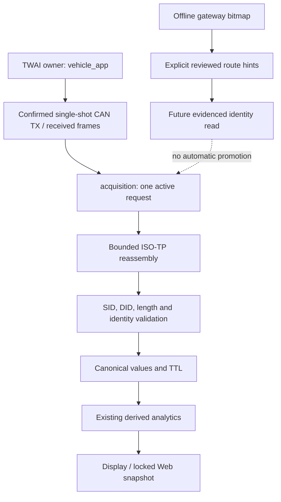

# Diagnostic discovery: bounded extensions to the existing stack

2026-10-22; baseline d9cca9d. [Evidence and source IDs](../research/vag-diagnostics-deep-research.md).
This is an incremental design, not a second diagnostic stack. P0/P1 and additive
Web evidence are implemented; gateway hints are experimental, host-only and offline.

## Ownership and trust boundaries



Only the CAN task consumes driver alerts and owns the active exchange. HTTP and
UI consume snapshots. FC shares the same bus/readiness/service policy gate as
application traffic. A hint, cached identity or profile checkbox cannot start TX.
`vehicle_app.c` still supplies `profile=NULL`; no new firmware UDS query is enabled.
The 11-bit/500 kbit OBD preset and 29-bit receive visibility remain separate.

## Component decisions

| Requested component | Existing implementation extended / retained |
|---|---|
| Connection Doctor | `validation_json.c` adds observations to the existing locked snapshot. `webui.html` GET-only button explains them; physical diagnostics counters remain. No claim of exact electrical cause. |
| Vehicle Discovery Manager | `acquisition.c` already performs bounded functional OBD supported-PID discovery, selects an engine responder, then VIN/identity. Host `discovery.py` already reads explicitly configured endpoints. No generic ID sweep. |
| ECU Registry | Existing host `DiscoveredEcu`, `DiscoverySnapshot`, `EcuIdentity` and `verify_discovered_identity`. Firmware `responders[8]` retains OBD discovery and a single manufacturer profile. Multi-ECU firmware registry deferred. |
| Read-only UDS | Existing native transport/acquisition and host `ReadClient`. Harden framing/timing, retain request allowlist. Native multi-frame TX is unnecessary for single-DID reads and not added. |
| DID Capability Registry | Existing `SignalRegistry`/provenance/applicability plus compiled profile. No new DQ500/Haldex scaling or DID permission inferred from a bitmap. |
| Adaptive Polling | Existing visible/background demand, TTL rescue, due times, per-binding failure suppression, one in-flight request, 100 ms floor (250 ms validation mode). Pending responses never trigger a resend. |
| Diagnostic UI | Existing Web `/api/validation`, trace96/exchange16 rings, physical counters, historical NVS incident. Additive JSON; no schema/NVS migration. |
| Offline Replay | Existing actual C acquisition harness over VirtualBus and host replay. New synthetic malformed/pending/gateway tests use existing mechanisms. |

## Two discovery approaches

### A. Gateway-based, future vehicle-gated path

1. Establish a successful controller-confirmed OBD transmission on the car before
   any new active UDS path is enabled. Keep current production defaults.
2. Obtain a legally available, exact vehicle gateway request/response pair and
   identity from an authorized diagnostic session. S01/S05/S07 suggest 710/77A
   for J533 but do not grant permission/applicability for this Tiguan.
3. Read identity in default session with explicit evidence-backed probes, e.g.
   F187 part number, F189 software version, F191 hardware number, F197 system name,
   F19E ASAM/ODX-related identity where supported. F190 is VIN, not complete ECU
   identity. These candidate names do not prove a particular payload layout;
   existing IdentityProbe must be configured with observed representation.
4. Only after gateway-specific layout evidence, consider one 22/2A26 read or an
   explicitly justified 04A3 alternative. No automatic DID fallback sweep or 2A28
   reachability interpretation. NRC31/timeout leaves inventory unknown.
5. Experimental `parse_gateway_bitmap(did, payload)` requires exactly 32 data
   bytes after validated positive SID/DID echo; returns LSB bit positions only.
   `plan_gateway_hints` intersects them with an explicit map of `EcuIdentity`
   pairs. It rejects duplicate/cross-direction CAN-ID collisions even on unset
   bits. It performs no I/O, inferred `700+bit`, response offset or cache write.
6. A listed hint becomes an observed ECU only through a separate bounded identity
   exchange. Inventory membership, communication, identity and metric capability
   are four distinct states. Missing bits do not exclude powertrain/gateway or
   prove absence; S01's own inventory omits those endpoints.

Illustration using deliberately artificial offline data (not car addresses):

```python
from minidash_live.discovery import parse_gateway_bitmap, plan_gateway_hints
from minidash_live.identity import EcuIdentity
payload = bytes([4]) + bytes(31)
assert parse_gateway_bitmap(0x2A26, payload) == (2,)
hints = plan_gateway_hints(0x2A26, payload, {
    2: EcuIdentity(logical_role='fixture', request_id=0x600, response_id=0x650)
})
# hints are not DiscoveredEcu and cannot start acquisition.
```

No gateway-request CLI or MCU auto-probe is introduced. The parser is a way to
review future captured evidence without a car, not completed active discovery.

### B. Limited read-only fallback

Retain standard OBD 7DF/0100 collection of 7E8..7EF responders; choose the
RPM-capable ECU and use its corresponding physical 7E0..7E7 pair. This is the
existing bounded standard path, not a whole-vehicle inventory. If gateway access
is absent/unsupported, the optional future manufacturer path uses only exact
reviewed per-vehicle endpoints and a short explicit identity DID allowlist,
one request at a time, default session, no retries outside the existing budget.
Stop at the first transport fault; timeout means unknown/unavailable, not absent.
No 700..7FF scans, arbitrary DID scans, session hopping or SecurityAccess.

VCDS logical numbers (01/02/19/22/17) must stay distinct from CAN identifiers.
The +8 powertrain and +6A non-powertrain patterns in S01/S05/S07 are contextual
observations. Source S09 has both 11-bit and 29-bit Haldex routes on a different
bus. Store an explicitly verified pair and address format; do not derive them
from logical module numbers or import a map from another MQB model.

## Timing and diagnostic evidence contracts

Native default-session policy: first response500 ms; UDS after NRC78 P2*=5000 ms;
absolute UDS total10000 ms; at most3 accepted pending responses. Non-UDS total
remains2000 ms. ISO-TP N_Cr250 ms is independent of first-response P2 once a valid
FF arrives. Every accepted CF must have expected SN and sufficient received DLC.
Requests and FC remain DLC8/padding00; unpadded complete SF/final CF are accepted.
The local timing policy is not a negotiated session contract or ISO certification.
RX and tick both enforce expiry, using wrap-safe elapsed arithmetic.

`connection_doctor.code`: disabled → controller unavailable → passive mode →
ECU observed → TX confirmed/no ECU → TX unconfirmed → RX-only → no bus evidence.
This ordering describes observations; historical `bus_off_observed`, ACK/bit and
RX loss flags stay separate. `root_cause_confirmed=false`, `vehicle_validated=false`.
ECU observed does not imply current fresh metrics. `counter_scope` explicitly says
since boot, not current transaction. Snapshot may contain VIN/raw payloads and
must stay private unless manually sanitized; the doctor itself exposes no VIN.

No new persistence. Existing snapshot reload does not revalidate identity;
`verify_discovered_identity` must succeed after reconnect. Synthetic tests exercise
matching/replaced identity, missing gateway and snapshot JSON roundtrip. They are
not MCU NVS power-loss tests. Existing calibration/NVS/partitions remain unchanged.

## Prioritized roadmap and acceptance gates

| Priority | Next step / components | Acceptance / evidence / principal risk |
|---|---|---|
| P0 | Car validation of canfix19 or reviewed successor; TWAI/status | Exact build, mode, confirmed TX, ACK/bit/TEC/REC/RX-drop deltas and request/response recorded. Physical ACK still does not identify ECU. |
| P1 | Firmware build/bench and vehicle receive timing; acquisition/ISO-TP | Replay passes, actual FC/SN behavior captured and no listen-only TX. Tune bounded P2/N_Cr only with measured evidence; do not hide load problems by extending all waits. |
| P2 | J533 identity and inventory evidence; host discovery/profile data | Exact gateway identity, positive/negative DID exchange, legal provenance, reviewed bit-to-route semantics and no collisions. Current helper remains experimental until then. |
| P2 | Native multi-ECU registry/cache | Bounded per-route state, bus/IDE, no cache-authorized TX, exact identity recheck after reboot/reconnect and measured RAM/stack budget. Requires P0 and reliable routes. |
| P3 | DQ500/Haldex bindings into existing scheduler | Exact ASAM/software, legal DID definition, length/byte order/scale/unit, comparison with authorized reference across safe operating points. Pump current/estimated torque are not measured pressure/torque. |
| P4 | Physical-screen registry/doctor and sanitized evidence export | On-device layout/touch/load tests; privacy-safe export proven for fragmented VIN and arbitrary payloads. Current raw download remains private. |

No merge, flashing or hardware alterations are part of this delivery. Apply only
reviewed commits after testing; the feature branch leaves integration unchanged.
