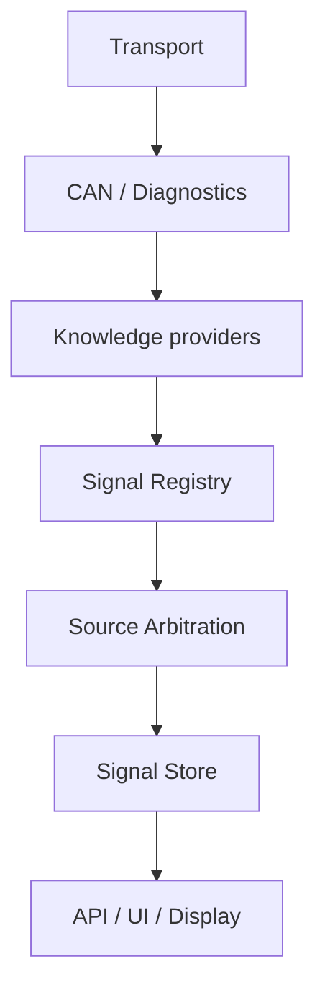

# Vehicle knowledge architecture

Status: implemented foundation on `feature/diagnostic-data-import`.

## Boundary

MiniDash core operates on vehicle/ECU identity, source definitions, canonical
signals and current readings. It does not contain MQB CAN IDs, VAG DIDs, ODIS
names or assumptions about CZPA/DQ500.

* VW Tiguan II 2017 CZPA/DQ500/4Motion is the first reference validation
  vehicle, not an architectural boundary.
* MQB is the first full platform knowledge dataset, not an architectural
  boundary.
* VAG is the first manufacturer knowledge provider, not an architectural
  boundary.



Transport/session code owns communication. A knowledge provider supplies data;
it never opens a bus or enters a diagnostic session.

## Identity

`VehicleIdentity` describes the containing vehicle:

* manufacturer;
* platform;
* model and model year;
* VIN when a definition truly has vehicle-specific scope.

`EcuIdentity` describes one controller:

* logical role and diagnostic addressing;
* part/software and hardware identity;
* diagnostic/ASAM identifier and version;
* ECU family and supplier.

`IdentityContext` carries both objects. Values are normalized for comparison.
Missing observed data never matches a required selector. Schema-v1 flat
dictionaries remain accepted at the boundary, including aliases such as
`sw_part`; serialized identity may also use explicit `vehicle` and `ecu`
objects, but core resolution uses typed identity.

An identity is observed state, not authority. Reading a part number does not by
itself make a decoder safe; applicability and validation evidence are separate.

## Applicability and semantic specificity

`Applicability` is an immutable set of required identity selectors. A
definition matches only when every selected field is present and equal.

Resolution uses semantic scope, not selector count:

1. exact ECU fingerprint (part + software plus hardware/ASAM identity);
2. software/diagnostic revision (part + software, ASAM + version, or ASAM +
   software);
3. diagnostic variant/ASAM;
4. exact vehicle/model scope;
5. ECU family/supplier;
6. platform;
7. manufacturer;
8. explicitly generic definition.

The remaining semantic vector and selector count only discriminate definitions
inside the same scope. If two applicable definitions remain equally specific,
resolution fails with `ConflictingDefinitionError`; load order is never a
tie-breaker.

Example: `{platform: MQB, ecu_family: DQ500}` no longer ties with
`{asam_id: EV_TCMDQ500021, software_version: 001001}`. The latter is a
software/diagnostic revision and wins.

Generic definitions are explicit definitions with no selectors. They do not
make a platform/family definition match incomplete identity. A generic source
should only be created where the protocol/meaning really is generic.

## Signal definition

`SignalDefinition` contains:

* stable definition ID and provider ID;
* platform-independent `canonical_name`;
* logical ECU role;
* CAN or UDS source route;
* applicability;
* scalar decoder, unit, TTL and optional expected update period;
* provider metadata;
* provenance and validation evidence.

Transport objects, sessions and polling state are deliberately absent.

The registry can return all independent applicable implementations of one
canonical signal. Specificity is resolved separately within each physical
source route, allowing CAN and UDS implementations to coexist.

## Canonical and raw signals

Canonical names describe meaning, never how a value was obtained:

* `engine.rpm`;
* `engine.coolant_temperature`;
* `vehicle.speed`;
* `wheel.front_left.speed`;
* `transmission.gear`;
* `awd.clutch_temperature`.

Core/UI must not derive meaning from a DBC signal name, CAN ID, DID, ASAM ID or
ECU part number.

MCD values without an explicit semantic mapping use a distinct raw namespace:

`raw.<provider>.<ecu-role>.<did>.<slug>`

For example:

`raw.vag.engine.2222.engine.speed`

The raw value remains discoverable without pretending that an engineering label
is a stable product API. A reviewed `canonical_map` can promote it to a
canonical name later.

Some legacy ECU profile names still use abbreviations such as `_temp`. Those
profiles remain evidence handoff files and are not silently rewritten in this
change. New registry datasets use the normalized namespace; migrating legacy
profile names requires an explicit compatibility/alias decision at their API
integration point.

## Knowledge providers

`KnowledgeProvider` is intentionally small:

* provider metadata;
* an iterable of `SignalDefinition` objects.

`registry_from_providers()` validates provider ownership and builds the common
registry. Identity discovery and transport selection are not provider methods
yet because the runtime does not have a stable cross-transport discovery
contract. Adding speculative hooks now would create a framework without a real
consumer.

`VagKnowledgeProvider` is the first implementation. It loads the existing
openDBC mapping and Haldex candidate dataset. Future VAG PQ/MLB datasets can be
added to that provider without modifying registry core. The synthetic `TEST`
provider in tests proves that core has no VAG requirement.

## Provenance and validation evidence

Provenance retains:

* origin;
* confidence: `confirmed`, `documented`, `candidate`, `guessed`;
* source URL;
* verification scope and notes;
* schema-v1 `vehicle_tested` compatibility;
* zero or more identity-scoped `ValidationEvidence` records.

Evidence records contain scope, method, pass/fail result, exact tested identity,
date and notes. This distinguishes:

* a definition documented in a database;
* DID/name association observed in ODIS;
* raw decoder compared against a physical/ODIS value;
* validation on one exact ECU/software combination.

New code checks identity-scoped `raw_decode` evidence before promoting decoded
quality to `valid`. The coarse legacy boolean remains readable but should not be
used for new data. Evidence is itself resolved by semantic specificity; an
exact ECU result overrides generic evidence, while contradictory equally
specific results fail closed rather than depending on array order.

## Source arbitration

`SignalStore` now keys rows by implementation (`definition_id`) as well as ECU,
canonical signal and source kind. Two CAN definitions or two UDS implementations
therefore cannot silently overwrite one another.

`SourceArbitrator` is deliberately conservative. It excludes stale, invalid and
unavailable rows, then considers:

1. runtime quality;
2. definition confidence;
3. freshness relative to TTL/expected period;
4. active acquisition cost.

CAN is not globally hard-coded above UDS. A fresh confirmed UDS value beats a
candidate CAN value; equally reliable/fresh passive CAN normally wins on lower
active cost. An exact tie raises `AmbiguousSourceError` rather than choosing by
insertion order. This is a foundation, not a final bus-budget optimizer.

## MCD import

The importer continues to support the original top-level MWB array. It also
accepts an envelope:

```json
{
  "metadata": {
    "provider_id": "vag",
    "platform": "MQB",
    "base_variant": "BV_...",
    "ecu_variant": "EV_...",
    "asam_id": "EV_...",
    "asam_version": "001"
  },
  "records": []
}
```

Identity selectors are derived from this metadata. Base/ECU variant
relationships are preserved in definition metadata. Explicit caller selectors
remain available for legacy dumps, and contradictory metadata is rejected.

The decoder subset remains intentionally small: one fixed byte-aligned numeric
value with `IDENTICAL` or a safe simple `LINEAR` formula. MUX, dynamic fields,
multiple parameters, text tables and rational/piecewise formulas still produce
an unsupported report instead of guessed decoding.

## Intentionally deferred

* no manufacturer plugin discovery or dependency-injection framework;
* no BMW/Mercedes knowledge implementation;
* no automatic semantic mapping of arbitrary MCD labels;
* no complete MCD DOP engine;
* no final arbitration optimizer or bus-load planner;
* no mass relocation of existing transport/runtime modules;
* no automatic promotion of community data to confirmed status;
* no merge into a base branch.

These require real consumers or vehicle evidence. The current boundary removes
the first-vehicle coupling without turning MiniDash into a general automotive
SDK.
