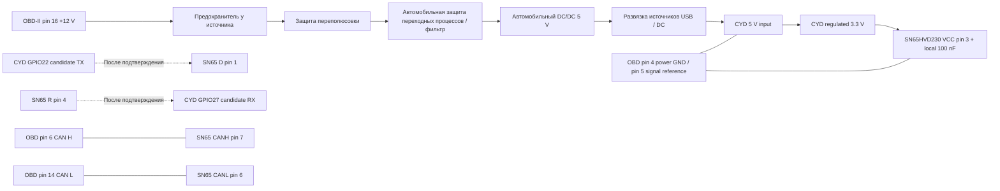

# MiniDash CYD — отдельная платформа ESP32-2432S028R

Обновление 20 октября: [CYD 0.5.0: переключатель DEMO и подготовка CAN](minidash-cyd-can-mode-2026-10-20.md).

Статус исходной поставки и фактические тесты: [отчёт 18 октября 2026](minidash-cyd-2026-10-18.md).
Это дополнительный профиль, существующие ESP32-S3/ST7789/ILI9341 остаются в проекте.
Не использовать CYD-бинарник на S3 и наоборот.

## Сборка

ESP-IDF 5.5.5, те же компоненты, что в существующем `firmware/dependencies.lock`:
esp_lcd_ili9341 2.0.2, esp_lvgl_port 2.9.0, LVGL 9.5.0.
CYD использует отдельный `dependencies.cyd.lock` с target esp32 и теми же
версиями/хешами. Component Manager не переписывает S3 lock при смене target.
В экспортированном окружении SDK, из корня репозитория:

```powershell
python tools/build_firmware.py minidash_cyd
python tools/build_firmware.py esp32_s3
```

Для подготовленных через `tools/prepare_locked_components.py` компонентов:

```powershell
$env:IDF_COMPONENT_MANAGER = '0'
python tools/build_firmware.py minidash_cyd --components artifacts/local/pinned-components
python tools/build_firmware.py esp32_s3 --components artifacts/local/pinned-components
```

Эквивалент CYD: `idf.py -C firmware -B build-minidash_cyd -DMINIDASH_BOARD=minidash_cyd build`.
Профиль выбирает ESP32, `sdkconfig.cyd.generated` и самостоятельный
`sdkconfig.cyd`; S3 defaults к нему не добавляются. Раздельные build/config
обязательны. Сборка сама не прошивает устройство. Исходные S3 presets не менялись.

## Что переиспользуется

Существующие display_manager, ILI9341 backend, LVGL renderer, темы/шрифты,
layouts, touch gestures/affine calibration, schema 4, NVS и `webui.html`.
Демонстрационные данные публикуются через существующий canonical signal store
с `demo=true`; реальный автомобиль и диагностический адаптер не нужны.
Исходные CAN/ISO-TP/acquisition/analytics, Python runtime и desktop simulator
сохраняются. Параллельного UI или отдельного Web Configurator нет.

CYD: 4 МБ flash, internal SRAM, нет PSRAM и BLE. CPU 240 МГц, SPI TFT 20 МГц, модель UI 5 Гц. Один частичный DMA-буфер
320×16 RGB565. В SRAM находится только текущая LVGL-сцена, при навигации
она освобождается и создаётся теми же builders, что используются на S3.
Массивы полей выделяются по вместимости текущего экрана. Не создаётся большой минутный analytics buffer S3.
Поэтому производные минутные/trip/session показатели и event rules на CYD
не вычисляются; их редактор/каталог сохранены для совместимости, но такие
виджеты остаются unavailable. Это ограничение, а не нулевые измерения.
Нет OTA, microSD и аудио. Подсветка — GPIO21; с cyd-0.3.0-light есть ручной
режим и AUTO от R21/GPIO34. [Реализация и проверка](minidash-cyd-light-2026-10-19.md).

## GPIO: профиль классического single micro-USB CYD

Это карта выбранного аппаратного варианта. Фактическое подтверждение конкретной
платы (LCD read-ID, touch, измерения) см. в отчёте. Имя корпуса не доказывает
контроллер панели: варианты USB-C/ST7789 требуют другой проверки и профиля.

| Узел | GPIO | Примечание |
|---|---|---|
| TFT ILI9341 SCLK | 14 | SPI2/HSPI |
| TFT MOSI / MISO | 13 / 12 | GPIO12 — boot strap, не подтягивать вверх внешне |
| TFT CS / DC | 15 / 2 | Страповые выводы, не использовать для CAN |
| TFT reset | -1 | Отдельный GPIO не назначен, software reset |
| TFT backlight | 21 | Active high LEDC, 10–100%, NVS |
| XPT2046 SCLK | 25 | Отдельный SPI3; не разделяет TFT bus |
| Touch MOSI / MISO | 32 / 39 | 39 только input |
| Touch CS / IRQ | 33 / 36 | IRQ не используется; чтение polling |
| microSD CS/SCLK/MISO/MOSI | 5/18/19/23 | Зарезервированы, microSD не инициализируется |
| RGB LED | 4/16/17 | Active low, не задействованы |
| LDR R21 | 34 | ADC1_CH6, автояркость (0 dB, 12 bit) |
| Audio | 26 | Не задействован |
| USB UART TX/RX | 1/3 | CH340, консоль 115200 |
| Boot | 0 | Не использовать для CAN |
| Кандидат CAN TX | 22 | CN1/P3, не конфликтует с TFT/touch |
| Кандидат CAN RX | 27 | CN1; проверить маркировку и прозвонить |
| Альтернативный RX | 35 | P3, только input, без внутренней подтяжки |
| Flash | 6–11 | Не использовать |

GPIO22 на P3 и CN1 — одна линия. На некоторых ревизиях подписи CN1 отличаются;
не подключать по расположению контактов без проверки. С CYD 0.5.0 TWAI включён
в сборку: DEMO останавливает драйвер, DEMO OFF устанавливает LISTEN_ONLY
(без ACK/error/TX). Передача стандартных OBD запросов заблокирована до отдельного
подтверждения проверенной проводки; разрешение
теряется при перезапуске/смене источника. UDS профиля нет. См. новый отчёт.

## Работа интерфейса

При старте сразу обычный dashboard. Settings → Demo mode (последняя страница)
переключает источник без прошивки; выбор сохраняется в отдельном NVS ключе.
Первый запуск по умолчанию DEMO. В DEMO работает симуляция: RPM 850–5200, скорость 0–130 км/ч,
температуры, нагрузка, boost 0–1400 hPa, напряжение 13.8–14.4 В, передачи 1–6.
DEMO не является признаком связи с ECU. Неподдержанные сигналы не заполняются
выдуманными значениями. Симулятор не переводит UI в состояние DRIVING, поэтому
его скорость не блокирует ручную настройку.

Пока калибровки нет: tap — следующий экран, double tap — предыдущий, hold —
Settings. В Settings tap выбирает следующую строку, double tap меняет значение,
hold возвращает назад. Touch calibration — существующая строка 8 (индекс 7):
пять точек, отпускать палец между касаниями. После калибровки работают зоны
prev/next, выбор строк/карточек, удержание и кнопки управления. Результат
сохраняется в отдельном NVS blob вместе с геометрией и базовым поворотом.

Settings → Wi-Fi configuration → Enable запускает AP MiniDash-xxxxxx.
Пароль и Wi-Fi QR (`WIFI:T:WPA;S:...;P:...;;`) показаны на отдельном экране.
QR подключает телефон к WPA2 AP; DNS/DHCP и HTTP redirect предлагают портал.
Резерв: `http://192.168.4.1`. Автопоказ портала зависит от ОС телефона,
HTTPS-пробы не перехватываются. У AP нет доступа в интернет.
Back возвращает из QR к Settings, не останавливая AP; Home — к приборам.
Settings → Wi-Fi → Disable закрывает DNS/HTTP, останавливает Wi-Fi и освобождает
интерфейс. Через 10 минут AP выключается автоматически. Wi-Fi не сохраняется
как включённый при перезагрузке. UART `config` не обходит ручной путь на CYD; `web-test` работает только
после Enable в Settings и сам не включает/выключает Wi-Fi; для стенда можно навигировать обычными UART-командами.

Web Configurator использует существующие session token, revision, Preview /
Save / Cancel и NVS schema 4. Preview временный; Save сохраняет. Выключение AP
отменяет несохранённый preview и не останавливает источник сигналов.
Для тестов: `status`, `ui-test`, `config-export`, `backlight-status`, `settings`,
`down`, `select`, `plus`, `back`, `home`, `reboot`. `status` сообщает heap,
readiness, screen, calibration, RPM/speed с DEMO-флагами.

## Питание и CAN — проект для согласования, не разрешение подключения



SN65HVD230: VCC pin3 = **3.3 В**, GND pin2, D pin1 = ESP TX, R pin4 = ESP RX,
CANH pin7, CANL pin6. Pin8 RS: high — standby (receive available, transmitter
disabled); low — high speed; slope resistor выбирается по datasheet и шине.
На модуле RS уже может быть соединён с GND; проверить мультиметром. Vref pin5
не является выходом питания для CYD. Модуль CAN не питать от 5 В.

Номинал предохранителя выбирается после измерения рабочего/пускового тока и
по допустимому току проводов. DC/DC и TVS должны совместно выдерживать
автомобильные импульсы, обратную полярность, холодный запуск и нагрев; обычный
USB buck без такой проверки не считается автомобильным решением. Не подавать
12 В на CYD. Не соединять одновременно выход DC/DC и USB 5 В ПК без развязки.
Схема не включает ignition/sleep control: OBD16 обычно постоянно под напряжением;
до установки требуется проверка потребления стоянки/отключение питания.

У исправной уже оконцованной CAN-шины два терминатора 120 Ом на концах,
параллельно около 60 Ом при обесточенной сети (точная процедура — для автомобиля).
Диагностический ответвитель у OBD обычно **не добавляет** третий 120 Ом.
Синий SN65HVD230 breakout часто имеет встроенный 120 Ом: наличие на данном
модуле неизвестно до осмотра/измерения. На изолированном двухузловом стенде
терминаторы нужны на обоих физических концах. Сопротивление измерять только
на обесточенной и безопасно отключённой цепи. Не делать вывод о терминации
по работающему NerdMiner или по программному тесту TWAI.

Перед активацией передачи в установленной CAN-сборке: фото/маркировка платы и модуля, прозвонка
GPIO22/27, измерения VCC/GND/терминатора, схема защиты/питания, подтверждение
подключения к конкретной шине. Затем изолированный стенд, listen-only без ACK,
bus-off/recovery, и только после отдельного подтверждения — стандартные запросы.

## Backup, прошивка и восстановление

Полный 4 МБ backup содержит приватные настройки NerdMiner. Хранить локально,
не коммитить и не публиковать. Для нового устройства сначала:

```powershell
python -m serial.tools.list_ports -v
python -m esptool --port COM4 flash-id
python -m esptool --port COM4 --baud 115200 --after no-reset read-flash 0 ALL nerdminer-original.bin
python -m esptool --port COM4 --baud 115200 --before no-reset --after no-reset verify-flash 0 nerdminer-original.bin
Get-FileHash nerdminer-original.bin -Algorithm SHA256
```

Успешные чтение, размер 4194304 и `verify-flash` обязательны. `no-reset` не даёт
майнеру обновить NVS между чтением и проверкой. SHA256 без проверки чтения не
доказывает совпадение с flash. Не менять eFuse, secure boot или flash encryption.

Готовый объединённый образ CYD прошивается **по адресу 0**, после проверки
backup и отсутствия внешнего питания/CAN. Команды есть в поставляемом пакете:

```powershell
python -m esptool --chip esp32 --port COM4 --baud 115200 write-flash 0 minidash-cyd-merged.bin
python -m esptool --chip esp32 --port COM4 --baud 115200 verify-flash 0 minidash-cyd-merged.bin
```

Для сохранения CYD NVS при обновлении использовать отдельные bootloader
0x1000, partition-table 0x8000 и app 0x10000 из той же сборки. Объединённый
установочный образ содержит пустые промежутки и предназначен для установки,
а не сохранения уже настроенного NVS.

Восстановление: проверить SHA256 полного оригинала, затем `write-flash 0
nerdminer-original-stable-4mb.bin`, после записи `verify-flash 0 ...`.
Не использовать erase-flash как обязательный шаг. Если автозагрузка не работает,
удерживать BOOT при подключении/RESET, отпустить после Connecting. Закрыть
другие serial monitors перед любым esptool. Flash восстанавливает исходные
разделы/NVS/SPIFFS, но не отменяет изменения eFuse (они здесь не выполняются).

## Последовательная консоль Windows

`python tools/cyd_serial_console.py --port COM4 --log cyd-boot.log --reset --commands status --seconds 10`
сохраняет реальный boot и состояние, не прошивая плату. Явно переданные команды
`home`, `settings`, `down`, `select` используют ту же навигацию, что touch.
`web-test` работает только после ручного включения AP в Settings; он запускает
внутренний HTTP-клиент на ESP32 и не заменяет проверку телефона.
`python tools/cyd_http_acceptance.py --help` описывает внешнюю проверку после
подключения ПК к AP. Команда `config` на CYD не включает Wi-Fi.

## Источники

- [CYD pin map](https://github.com/witnessmenow/ESP32-Cheap-Yellow-Display/blob/main/PINS.md) — выводы классического варианта, не доказательство ревизии конкретной платы.
- [ESP32 TWAI](https://docs.espressif.com/projects/esp-idf/en/v5.4/esp32/api-reference/peripherals/twai.html) — внешний трансивер, GPIO matrix, listen-only.
- [ESP32-WROOM-32E](https://documentation.espressif.com/esp32-wroom-32e_esp32-wroom-32ue_datasheet_en.html) — аппаратные ограничения.
- [TI SN65HVD230](https://www.ti.com/lit/ds/symlink/sn65hvd230.pdf) — 3.3 В, D/R, RS, терминация.

Новый код написан внутри существующей MIT codebase. Схемы/сторонний код не
копировались; версии и лицензии зависимостей сохранены.
