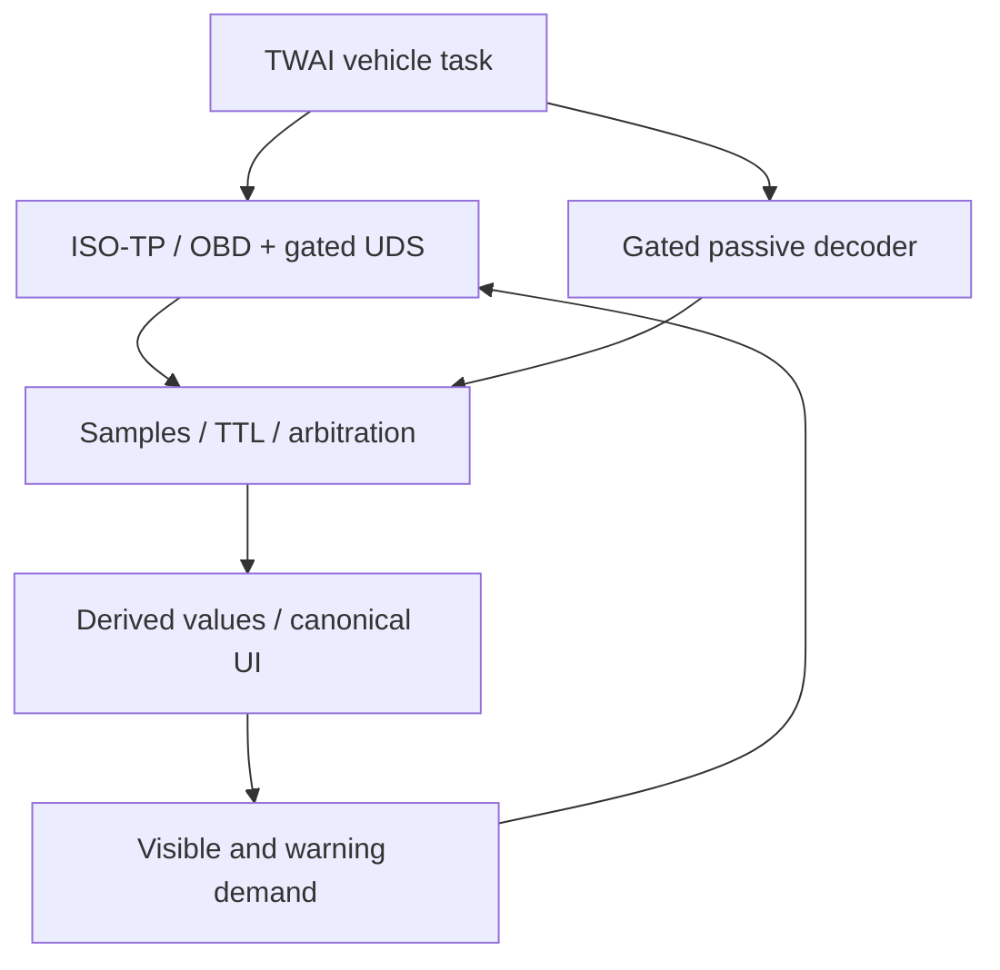

# MiniDash standalone: итог реализации и границы проверки

Обновлено при восстановлении 2026-10-03 UTC / 2026-10-04 Minsk.
Ветка `feature/standalone-acquisition`. Baseline consolidation `3e5c6ca`, runtime
`18095539`, startup/ISO-TP hardening `4904233`. Main не меняется.

## Результат

На ESP32-S3 реализован автономный путь CAR/OBD → transceiver → TWAI → ISO-TP/OBD
→ samples/TTL/arbitration → физический LVGL UI. PC/Python/телефон/VNCI/ODIS/ELM
не входят в production path. Сохранены экраны, тач/NVS, темы, four Custom pages,
редактор на временном Wi-Fi AP и все host development/research tools.

Это **offline-tested firmware, не real-car PASS**. Проводка, transceiver, питание,
ток покоя и поведение на Tiguan не проверены. QUIET не electrical off; нужен KCD11.
VAG profiles выключены до точных VIN/ECU/endpoint/decoder evidence.

## Аудит и выбор архитектуры

До runtime checkpoint `app_main()` запускал UI и USB-консоль. Acquisition,
discovery, knowledge и arbitration выполнялись Python-процессом. Наличие дисплея
не означало автономность. Основной upgrade поэтому — firmware acquisition,
а не дополнительная косметика интерфейса.

| Компонент | Было | Теперь / ограничение |
|---|---|---|
| CAN HAL | Host transports | TWAI v2 task, checked TX4/RX5 installation preset |
| ISO-TP | Python | Bounded C RX128 bytes; single-frame requests |
| Discovery | Host identity workflow | Standard 11-bit/500-kbit OBD responders + capability bitmaps |
| Identity | Host models | Mode09 VIN; exact compiled ECU identity gate |
| Providers | Python knowledge | Compiled UDS/passive bindings with provenance/license/address gates; no profile enabled |
| Planner/store | Host | Visible/background demand, TTL, per-source samples, passive > UDS > OBD |
| UI | USB samples | Native canonical publishing, status/DTC touch action |
| Logs/replay | Host tools | Preserved; native RAM ring96 frames + C snapshot API |
| Sleep | UI state | QUIET stops requests/listens; no automatic power switch |
| DTC | Simulator/host plans | Read Mode03 selected emissions ECU only; max12; no clear |

Discovery/provider/planner/store разделены функциями portable `acquisition.c`;
HAL в `vehicle_app.c`, ISO-TP в `diagnostic_transport.c`. Это компактный runtime,
не ODX interpreter. Не переносим Python hierarchy или все host definitions.
База и прежние ветки сохранены; история объединения — в
[consolidation audit](repository-consolidation-2026-09-30.md).

## Реализованные ограничения и safety review

- Classical CAN11-bit/500 kbit, startup listen-only1.5 s, PID00 responders
  7E8…7EF, выбор поддерживающего RPM. Не угадывает адреса других VAG ECU.
- Capability blocks00/20/40, восемь OBD значений: RPM, speed, coolant, oil,
  load, MAP, baro, module voltage — только поддержанные. MAP−baro — derived boost.
  ECU voltage и MAP не подменяют battery-terminal voltage/charge-pressure DID.
- Одна transaction, ≥100 ms между application requests, no catch-up bursts.
  Видимые быстрые jobs имеют target200 ms, background≥1 s; это не измеренный load.
- Response500 ms, interframe250 ms, hard deadline2 s, bounded pending/retry.
  RX queue64, max32 frames/tick, delay10 ms, single-shot TX, bounded bus recovery.
- Manufacturer bindings: exact VIN/endpoint/identity response, provenance/license;
  `.profile=NULL` в поставке. Нет CAN FD/K-line/TP2.0/29-bit OBD/multi-frame TX,
  session switching/TesterPresent/security/routine/write/flash services.
- Startup: status mutex до UI, store до producer; engine initialization и failure
  status под lock. UI не вызывается под CAN mutex.
- ISO-TP service/PID/DID/address и declared length проверяются до Flow Control.
  Regression: matching RPM prefix с неправильной multi-frame длиной не вызывает TX.
- TTL/stale/unsupported/unknown не превращаются в нули. Profile mismatch закрывает
  manufacturer polling. DTC read требует свежей speed=0, clear отсутствует.
- QUIET после bounded failures или120 s свежих RPM=0/speed=0. Hold/manual retry,
  bus recovery или обычный трафик после паузы≥5 s могут перезапустить discovery.
  Долгий start-stop — известное ограничение, это не ignition detection.

## Проверки и восстановление среды

После очистки рабочей среды локальная копия оказалась на `18095539` с hardening
diff. Через GitHub подтверждён `4904233`, локальный tree совпал с
`7d6eab85b32c9667461bd95b7d2b1c4bc00039f6`; восстановлен точный commit object.
Ничьи изменения не сброшены. Поздний незакоммиченный HTTP export не сохранился
и **не включён** в эту поставку. Вместо заявления об утраченном результате
интеграционный test harness восстановлен и запущен заново.

| Gate | Текущее доказательство |
|---|---|
| Python | Свежий acceptance run; точные результаты в committed verification JSON |
| Native core/JSON/acquisition | CTest3/3, включая 8 сценариев, 50,000 malformed frames и hardening regression |
| Firmware integration | Actual C engine + python-can VirtualBus: VIN/DTC ISO-TP, loss, no-TX quiet, fault/reconnect, exact synthetic replay |
| Web | Node + C-derived fixture; не browser/device visual test |
| Memory safety | Portable ASan/UBSan; leak detector disabled из-за ограничений task metadata |
| Firmware | Исторический ESP-IDF5.5.5 standalone PASS сохранён в runtime report; свежая сборка после последней очистки не выполнена |
| Board/car | Не выполнено; ни одна плата этим продолжением не прошивалась |

Предыдущая сессия также выполняла три firmware builds и получила standalone
1629712, listen-only1629616, default1721616 bytes. Но те build artifacts/toolchain
утрачены, и они включали поздний HTTP export: **эти размеры не являются измерением
текущего дерева**. Не использовать их как release hashes или новый build PASS.
Потерянные логи не пересоздаются задним числом. Команды повторной сборки и тестов —
в [development](../development.md); новый JSON фиксирует только доступные проверки.

Native acquisition state был измерен как3504 bytes (host ABI), включая RAM trace
96×24=2304 bytes. CAN task stack6144 bytes; queue/status/UI/AP добавляют память.
Нет per-frame heap/flash writes. Runtime heap/high-water/FPS/coexistence на ESP32
не измерены. Factory app3 MiB, без A/B OTA. Размер режима с host self-tests нельзя
выдавать за чистую стоимость нового acquisition.

## Источники, файлы и продолжение

[Source/license review и матрица](standalone-sources-and-matrix.md) фиксируют
результаты исследования без импорта restricted/unlicensed кода и непроверенных DID.
[REAL_CAR_TEST](../../REAL_CAR_TEST.md) содержит wiring, presets, usage/recovery.

Runtime: acquisition/diagnostic_transport/vehicle_app .c/.h, main/display_app,
Kconfig/CMake/presets. Hardening: main/vehicle_app/acquisition/core regression.
Завершение: `core/acquisition_harness.c`, CMake, `tools/verify_standalone.py`,
обязательный gate в `verify_repository.py`, README/status/architecture/development,
UI usage, research reports, verification JSON, REAL_CAR_TEST. NVS schema и
partition table не менялись; factory backup не тронут.

| Приоритет | Цель / компоненты | Acceptance / риск / входные данные |
|---|---|---|
| P0 | Восстановить IDF toolchain и три builds | Fresh logs/config/hash, не исторические размеры; не flash |
| P0 | Power/transceiver/physical UI | ON/QUIET/OFF currents, no backfeed, crank/transient bench; правильная схема |
| P0 | Tiguan read-only validation | Cold boot→LIVE, supported PIDs vs reference, disconnect/reconnect; exact version/trace |
| P1 | Verified profile compiler | VIN/identity/endpoint/raw evidence + offline regressions до enabling DID |
| P1 | Passive/steering | OBD visibility, counter/checksum/invalid encoding, debounce; no button injection |
| P1 | Native diagnostics | Bounded ECU-scoped identity/0x19, licensed descriptions; clear отдельным guarded этапом |
| P2 | Trace export/logger | Bounded snapshot, VIN privacy, power-loss storage; текущий ring не trip logger |
| P2 | OTA/optional phone/Lite | Signed A/B rollback, memory budget, display/input HAL; телефон не runtime dependency |

Все safe offline изменения сохраняются в feature-ветке, без force/merge. Финальный
commit SHA проверяется после публикации, не встраивается как самоссылка в дерево.
