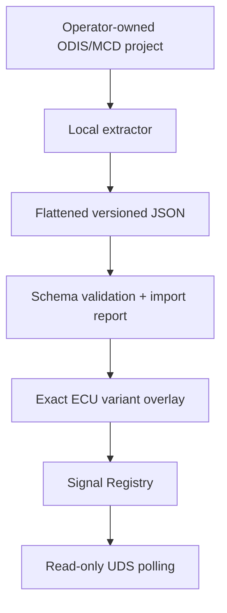
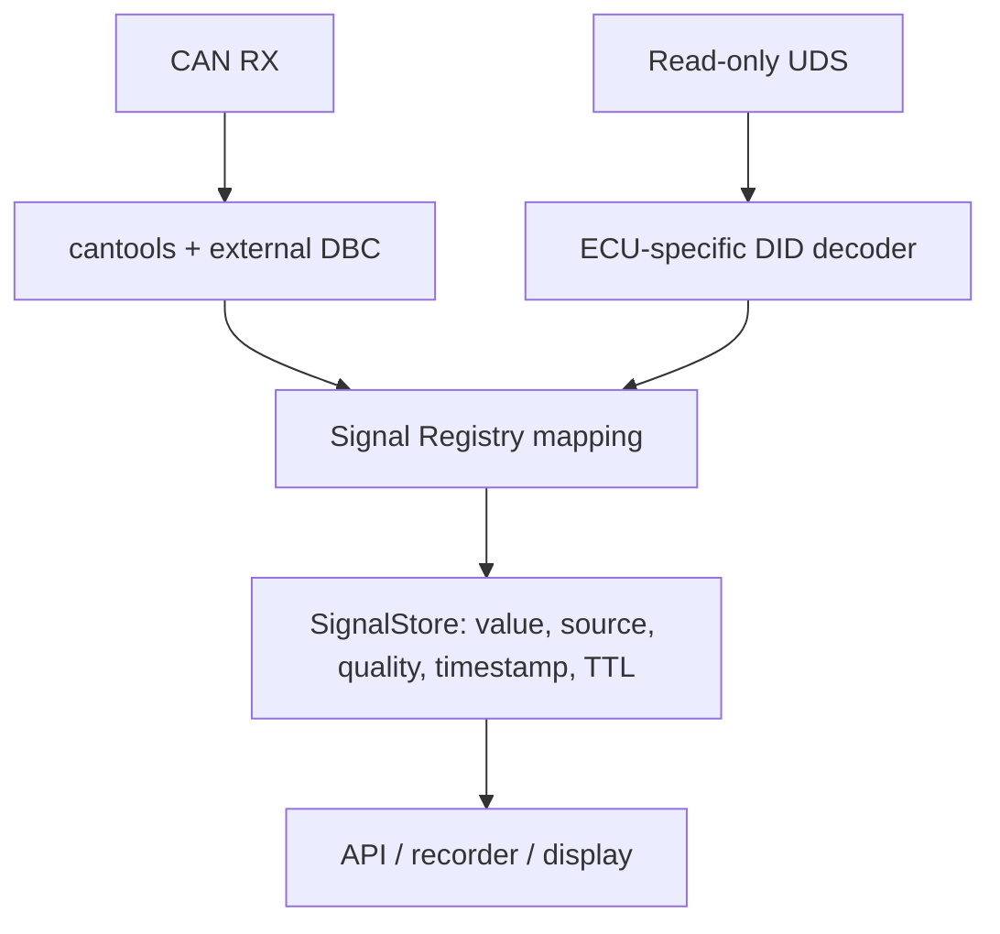

# VAG/MQB diagnostic knowledge sources

Research snapshot: 2026-09-25. This document separates facts present in an
upstream project from assumptions that still need a trace from the MiniDash
test vehicle.

## Executive decision

MiniDash should aggregate external knowledge, but must not merge all knowledge
into one unqualified table.

* Use `opendbc/vw_mqb.dbc` through `cantools` as the first passive-CAN source.
  Keep the DBC external/pinned and keep only the normalized-name mapping here.
* Generate a local diagnostic database from an operator-owned ODIS/MCD project.
  Store the flattened, reviewable output outside Git by default. Select the
  base variant and ECU-variant overlay using live identity, especially DIDs
  `F19E` and `F1A2`, plus the observed part/software fingerprint.
* Preserve the current strict MiniDash read-only UDS/runtime boundary. Do not
  import flash, coding, SecurityAccess, RoutineControl or ECU reset paths from
  more general diagnostic projects.
* Treat community DID formulas as candidates until the raw request, complete
  response, physical reference and ECU identity are captured together.

The new registry is intentionally a small compatibility layer. It does not
replace `EcuSession`, `Scheduler`, `SignalStore`, ECU profiles, `can-isotp` or
`udsoncan`.

## Source assessment

| Source | License | Useful content | Reliability / decision |
|---|---|---|---|
| [commaai/opendbc](https://github.com/commaai/opendbc) ([DBC](https://github.com/commaai/opendbc/blob/c4465696dc2ef0d1340ae188810ac982586999a4/opendbc/dbc/vw_mqb.dbc), [carstate.py](https://github.com/commaai/opendbc/blob/c4465696dc2ef0d1340ae188810ac982586999a4/opendbc/car/volkswagen/carstate.py), [values.py](https://github.com/commaai/opendbc/blob/c4465696dc2ef0d1340ae188810ac982586999a4/opendbc/car/volkswagen/values.py)) | MIT | DBC layouts/scaling plus active Volkswagen parser and platform routing | Best passive MQB baseline. Parser use confirms those messages are used on selected MQB configurations, not their presence on this Tiguan bus. Load with `cantools`; validate visibility and signal quality at the actual tap. |
| [aivs/blackCockpit](https://github.com/aivs/blackCockpit) and [Habr 442184](https://habr.com/ru/articles/442184/) | No repository license found | Octavia A5 UDS observations: `F40C`, `F40D`, `F405`, `202F`, `221B`, range/fuel/odometer and doors; historical passive RPM observation at `0x35B` | Metadata-only candidates. No code copied. Bindings are scoped to the reported Skoda/cluster route and do not resolve for the Tiguan. |
| [Habr 589653](https://habr.com/ru/companies/ruvds/articles/589653/) | Article; no separate code license | VAG diagnostic-dashboard architecture and VCDS observation context | Background, not proof that Octavia IDs or formulas apply to Tiguan. |
| [ODIS-project-explorer](https://github.com/kartoffelpflanze/ODIS-project-explorer) | No license found | `dumpMWB.py`/`parseMWB.py`, traversal of MCD DOPs, structures, units, constraints and compu methods | Strong proof that automatic extraction is practical. No license means its code must not be copied or redistributed without permission. ODIS data is not included. |
| [bri3d/mcd-diag-rs](https://github.com/bri3d/mcd-diag-rs) | BSD-3-Clause | Flattened MCD schema, base/ECU-variant overlay, routing, ECU discovery, J2534/SocketCAN/DoIP, tolerant decoding | Most useful reference for a local MCD-derived database. Import its documented JSON shape; do not transplant its write/flash capabilities into MiniDash. |
| [ConnorHowell/vag-uds-ids](https://github.com/ConnorHowell/vag-uds-ids) | No license found | Candidate VAG physical request/response IDs for Engine, TCU, ABS, AWD, ACC, Airbag, Cluster, Gateway and Steering | Candidate routing evidence only. No blind defaults and no vendoring. Confirm each pair on the actual bus/gateway. |
| [mrfixpl/MQB-sniffer](https://github.com/mrfixpl/MQB-sniffer) | No license found | Real Golf 7/DQ250 examples: Cluster `714/77E`, `22D1` RPM, `224D` light; DSG `3815` mode and `3816` engaged gear | Useful candidates, not DQ500/Tiguan truth. The example transport is incomplete and code cannot be copied without a license. |
| [ALagrandeur/mk7-cluster-bench-controller](https://github.com/ALagrandeur/mk7-cluster-bench-controller) | MIT | Bench-tested MQB frames/DIDs and an explicit confirmed/documented/guessed convention | Provenance convention is worth adopting. Vehicle-specific formulas remain candidates for CZPA/DQ500. |
| [Forbes-Automotive/OpenHaldex-C6](https://github.com/Forbes-Automotive/OpenHaldex-C6) | MIT | Gen5 Haldex UDS addressing and VCDS heat-sweep formulas for `028D`, `2BE4`, `2BF1`, `2BE6`, `2BE7`, `2BE9` | Exceptionally relevant to J492. Tests were on `0CQ 554C/554D`, not our `0CQ907554H`; imported as candidates only. |
| [cantools/cantools](https://github.com/cantools/cantools) | MIT | Mature DBC parsing: arbitrary bit fields, endian handling, multiplexing, choices and scaling | Use rather than extending MiniDash's byte-only scalar passive decoder into a second DBC implementation. |
| [pylessard/python-can-isotp](https://github.com/pylessard/python-can-isotp) | MIT | ISO-TP segmentation, flow control, timers and addressing | Already an optional MiniDash transport dependency. Retain it for PC transport instead of implementing ISO-TP again. |
| [pylessard/python-udsoncan](https://github.com/pylessard/python-udsoncan) | MIT | General UDS service/client implementation | Already used by the transport lab. Keep the small production `ReadClient` while its strict allowlist is a safety property; reconsider only when broader read-only services require it. |
| [dspl1236/simos-suite](https://github.com/dspl1236/simos-suite) | MIT | VAG diagnostic/logger patterns and MCD/PBL extraction experiments | Useful methodology; much of the project is flashing/security research and not a direct source for CZPA/DQ500 read-only definitions. |
| [dspl1236/VAG-CP-Docs](https://github.com/dspl1236/VAG-CP-Docs) | CC0 (as stated by project) | Public notes on Linux MCD/PBL extraction | Supporting extraction reference, not a signal catalog. |
| [r00li/CarCluster](https://github.com/r00li/CarCluster) | GPL-3.0 | MQB cluster/CAN implementation | Research only unless GPL compatibility is intentionally accepted; do not copy implementation into MiniDash. |
| [lilsteelan/cps3-dashboard](https://github.com/lilsteelan/cps3-dashboard) | No license found | ESP32 MQB dashboard experience, DBC-derived frames and the practical OBD-gateway visibility warning | Evidence and test ideas only; no code/data inclusion. |

“No license found” is not public-domain permission. Repository visibility alone
does not permit copying code or datasets. Facts independently verified on the
wire may be recorded with their own MiniDash trace provenance.

## openDBC `vw_mqb.dbc`

The pinned revision is `c4465696dc2ef0d1340ae188810ac982586999a4` (MIT). The
normalized definitions in `data/external/opendbc-vw-mqb-map.json` and
`data/external/opendbc-vw-mqb-candidates.json` record that exact source revision,
license, CAN identifier, DBC message/signal, known bit layout, scaling, units,
applicability status and unknown transmission period. The DBC itself remains
external and is loaded with optional `cantools`.

Relevant examples include:

| Normalized signal | DBC message / signal | DBC conversion |
|---|---|---|
| `engine.rpm` | `Motor_12 / MO_Drehzahl_01`, CAN `0x0A8` | bits 48–63, 16-bit LE, `0.25 rpm/bit`; separate quality bit |
| `vehicle.speed` | `ESP_21 / ESP_v_Signal`, CAN `0x0FD` | bits 32–47, `0.01 km/h/bit` |
| four wheel speeds | `ESP_19 / ESP_*_Radgeschw_02`, CAN `0x0B2` | 16-bit LE, `0.0075 km/h/bit`; no direct validity dependency imported |
| `engine.oil_temperature` | `Motor_07 / MO_Oel_Temp`, CAN `0x640` | bits 16–23, byte, `raw - 60 °C` |
| `engine.coolant_temperature` | `Motor_07 / MO_Kuehlmittel_Temp`, CAN `0x640` | bits 24–31, byte, `0.75*raw - 48 °C` |
| intake-air temperature | `Motor_07 / MO_Ansaugluft_Temp` | byte, `0.75*raw - 48 °C` |
| relative manifold pressure | `Motor_20` | documented in DBC, including CRC/counter |
| displayed/selected gear | `Getriebe_11 / GE_Fahrstufe` and related fields | enum/raw value in DBC |
| steering angle/rate | `LWI_01`, CAN `0x086` | 13-bit magnitude, `0.1°/bit`; sign and quality are separate bits |
| steering torque | `LH_EPS_03` | packed field plus sign/quality |
| brake pressure | `ESP_05`, CAN `0x106` | 10-bit `0.3*raw - 30 bar`; brake switch is separate |
| accelerator position | `Motor_20`, CAN `0x121` | 8-bit `0.4 %/bit`; Diesel sender, so CZPA remains candidate |
| ACC state/targets | `ACC_*` messages | multiple status and target fields |

The DBC also describes message counters, CRC fields and quality bits. Merely
decoding a physical value does not prove it is currently valid: quality fields
must be mapped into MiniDash validity rules in a later iteration.

Practical limitation: the OBD connector is often behind the MQB gateway. A DBC
can be perfectly correct while the corresponding broadcast frames are absent
at that connection point. Before choosing the final hardware/tap, record an
ignition-on drive trace and inventory observable IDs. Do not inject copied
broadcast frames just to “make” values visible.

The wider candidate table also records `ESP_02` acceleration/yaw, `GRA_ACC_01`
controls, DQ-hybrid-family gear/shift fields, `Motor_11` torque and its quality
bit, oil level, cluster odometer/fuel/ambient temperature, driver-door contact,
light requests and turn indicators. Relative manifold pressure from `Motor_20`
is a packed 6-bit field scaled by 18 mbar/bit. If a DBC definition does not
state a transmission period, MiniDash keeps it unknown; the rate must be
measured from capture.

This branch stores normalized signal mappings, not the DBC. Retain the upstream
DBC MIT notice if it is ever distributed with the product.

### Candidate status and user-requested cross-checks

The MQB DBC is a network-family definition, not a Tiguan II 2017 CZPA/DQ500
capture. Every imported DBC definition is `candidate`, `vehicle_tested=false`
and `external_unverified`. DBC decoding therefore remains candidate quality
until exact-vehicle validation evidence is recorded. Several message senders
are named Diesel or DQ Hybrid in the DBC; this is not proof of equivalent ECU
software or gateway visibility.

* `ESP_21/ESP_v_Signal`, `Motor_20` throttle/manifold pressure, `ESP_05` brake,
  `LWI_01`, `ESP_02`, and `GRA_ACC_01` have exact IDs/layouts in the normalized
  table; all still need a Tiguan trace.
* `Getriebe_11` (`0x0AD`) is sent by `Getriebe_DQ_Hybrid_MQB`. Actual gear,
  target gear and shift-sequence codes are stored raw. DQ500 semantics are not
  assigned from this hybrid-family node.
* `0x35B` passive RPM comes from the author's older Octavia capture, not the
  pinned openDBC DBC. The cantools CAN route cannot safely interpret that
  standalone observation as a DBC signal, so it remains a validation clue.
* Habr/blackCockpit DIDs are in
  `data/external/community-vag-uds-candidates.json` with `SKODA/OCTAVIA A5`,
  request `0x714`, response `0x77E`, no imported decoder and unknown polling
  frequency. That applicability does not resolve for the Tiguan. Habr reports
  `221B` button results `0x80` idle, `0x81` up, `0x84` down; these are raw
  observations, not a Tiguan enum.
* Community `F40C`, `F40D`, `F405`, `202F`, `1014`, `220D`, `2294`,
  `229A`, `2203`, `2299`, and `2216` transforms are not universal codecs.
  `11BD` is in the exact Tiguan CZPA profile; it was not found in the inspected
  blackCockpit source. `202F` is present in the older Octavia code, but that
  does not transfer its raw decoder to Tiguan.
* OpenHaldex remains a Gen5-family candidate from hardware `0CQ 554C/554D`; the
  Tiguan ECU is `0CQ907554H`. Provenance includes a pinned revision and MIT
  notice, including its third-party portions note.
* DTC records use UDS service `0x19`, not a DID. MiniDash's live client remains
  allowlisted to ReadDataByIdentifier and does not send DTC requests. Compare a
  read-only ODIS/VCDS DTC report during vehicle validation; do not clear codes.
  Service `0x19` needs a separately reviewed read-only capability.

## ODIS/MCD extraction feasibility

Automatic import is practical. An MCD measured value can contain much more than
`DID + scale`:

* byte and LSB-first bit positions;
* fixed, min/max and dynamic lengths;
* signed/two's-complement and endian rules;
* nested structures, arrays and multiplexers;
* `IDENTICAL`, `LINEAR`, rational/piecewise and `TEXTTABLE` computations;
* display unit plus SI factor/offset;
* physical/internal constraints and `NOT-AVAILABLE` ranges;
* base-variant definitions plus an ECU-variant overlay.

The safe pipeline is:

Do not commit the input databases. Generated data may also be contractually or
copyright restricted, so the default should be a local cache with hashes and a
manifest, not a repository-wide generated dump.

The current importer accepts the documented `mcd-diag-rs` top-level MWB array
and only compiles one byte-aligned fixed numeric `VALUE` with `IDENTICAL` or a
simple safe `LINEAR` formula. Every structure, mux, dynamic field, text table or
unknown formula is returned in `unsupported`; it is never approximated. This is
the foundation, not a complete MCD decoder.

### Variant binding

Use a data selector, not a class hierarchy:

1. identify the ECU using live `F190/F187/F189`-family identity records already
   captured by MiniDash, and `F19E` ASAM/ODX identifier plus `F1A2` version where
   supported;
2. select platform and base variant/routing information;
3. overlay only the matching ECU variant;
4. require exact critical fingerprint fields before applying a raw decoder;
5. retain unmatched values as raw evidence.

Prefix/revision fallback, as used by `mcd-diag-rs`, is useful for discovery but
must lower confidence and must not silently authorize a decoder.

## Current test-vehicle coverage

| ECU | What MiniDash already knows | Best external next source |
|---|---|---|
| J623 CZPA `5NA907115D/0003`, `EV_ECM20TFS0115NA907115D/001004` | Real identity and DID/name associations; F405 is the first exact-identity vehicle-tested raw codec (`uint8 - 40 degC`) | Exact MCD ECU-variant overlay plus the same synchronized validation method for remaining signals. |
| J743 DQ500 `0DL300011P/2004`, `EV_TCMDQ500021/001001` | Real identity and 29 DID/name associations; no raw codecs | Exact MCD overlay. MQB-sniffer's DQ250 `3815/3816` data is only a candidate; `3816` association is already seen on our DQ500. |
| J104 MK100 IPB `5Q0614517CE/0413` | Real identity and wheel/dynamics DID associations; no raw codecs | openDBC for fast passive wheel/vehicle dynamics; exact MCD for diagnostic-only values. |
| J492 Gen5 `0CQ907554H/7083`, `EV_AllWheelContrHA1VW37X/004013` | Real identity and seven live DID/name associations; no raw codecs | OpenHaldex formulas as candidates, then exact MCD and a synchronized MiniDash/ODIS raw capture. |
| Gateway | Not represented by a test-vehicle ECU profile in this branch | MCD routing + live discovery. Community IDs are candidates only. |
| Cluster | Not represented by a test-vehicle ECU profile in this branch | openDBC for passive display/status data; MCD for exact variant; MQB-sniffer DIDs only as candidates. |

An association confirmed in ODIS is not the same as a confirmed raw decoder.
The registry therefore keeps `verification_scope` separate from `confidence`
and `vehicle_tested`.

## Unified signal architecture

The generic identity/provider/applicability boundary is specified in
[Vehicle knowledge architecture](../architecture/vehicle-knowledge.md). VAG
and MQB are now dataset/provider concerns; `SignalRegistry`, `SignalStore` and
source arbitration contain no VAG selector names or Tiguan branching.

Definitions contain:

* stable definition ID and normalized name;
* source (`can` database/message/signal or `uds` ECU/DID);
* applicability selectors (platform, ECU family, ASAM ID/version, software
  part/version, and future vehicle qualifiers);
* decoder/unit/TTL where applicable;
* provenance origin, confidence, source URL, whether this vehicle was tested,
  and the exact verification scope.

Transport and sessions remain runtime services. The registry must never open a
bus, choose a J2534 DLL, enter a session or schedule a request.

## Passive CAN versus active UDS

Prefer passive CAN for high-rate values already broadcast and visible at the
chosen tap: RPM, vehicle/wheel speeds, accelerator/brake state, steering,
selected gear and fast ESP/ACC state. This eliminates diagnostic request load
and naturally synchronizes values at the producer's broadcast rate.

Prefer UDS for identity, sparse temperatures/pressures not broadcast, detailed
DQ500 clutch/mechatronic values, J492 internal values and on-demand research.
Temperatures do not justify high-rate polling. Exact rates must be derived from
measured response latency, ECU timing and the final signal set—not copied from
another project.

Where both paths provide the same normalized signal, retain both source rows in
`SignalStore`. A later arbitration policy may select a preferred current value,
but should expose disagreement and source quality instead of overwriting one
with the other.

## Conflicts to expect

* The same DID can mean different data in different ECU base/variant families.
* A label observed in ODIS proves the DID association, not raw byte layout.
* Community projects often omit ASAM ID/software revision and may describe a
  DQ250 while the test vehicle uses DQ500.
* DBC signal names and enums are network-contract names, not necessarily the
  desired stable MiniDash API names.
* DBC physical values may require a separate quality/sign field.
* ODIS `TEXTTABLE`, invalid ranges and piecewise/rational conversions can be
  lost by simplistic scalar exporters.
* Request/response CAN IDs differ by route, gateway exposure and module family.
  Community address lists are discovery hints, not safe defaults.

Resolution order should be: exact raw MiniDash trace on the exact fingerprint;
exact manufacturer MCD variant; documented network DBC; compatible ECU-family
measurement; then community candidate/guess. Conflicts are stored and surfaced,
not silently resolved by load order.

## What is implemented in this branch

* `SignalRegistry` with semantic applicability selection, duplicate/conflict
  rejection and unknown-DID raw fallback;
* provenance/confidence/verification-scope metadata;
* optional `cantools` adapter publishing decoded passive values into the
  existing `SignalStore`;
* normalized pinned MQB DBC mappings and separate metadata-only Octavia UDS candidates;
* candidate Gen5 Haldex DID codecs, explicitly not marked vehicle-tested;
* a conservative simple-scalar importer for locally generated
  `mcd-diag-rs`-shape MWB JSON plus a rejection report;
* synthetic tests for DBC scaling, MCD scaling/invalid values, stale values,
  unknown DIDs, unsupported variants and definition conflicts.

## Next engineering slice

1. Record raw passive CAN at the intended Tiguan connection point and inventory
   IDs against a pinned `vw_mqb.dbc` revision.
2. Capture one synchronized J492 cycle with complete UDS request/response,
   ODIS displayed values and exact identity; promote only matching codecs.
3. Run a local MCD extraction for the four known ASAM variants. Store only a
   manifest/hash and narrowly selected, legally reviewable generated artifacts.
4. Extend the importer in order: multiple fixed parameters, bit fields,
   `TEXTTABLE`, invalid constraints, then piecewise/rational formulas. Add a
   fixture and rejection test for every new construct.
5. Add DBC quality dependencies and source arbitration; only then assign final
   production polling budgets from traces.

## Reviewed local typed-scalar recovery (2026-09-30)

The original uncommitted MCD importer work was recovered into the isolated
research integration branch. Single fixed IEEE754 FLOAT32 (both byte orders)
and non-overlapping bounded TEXTTABLE choices now use the shared scalar codec
validator; signed invalid sentinels are retained. Unknown byte order, float
encoding, overlapping/default enum choices and non-finite values fail closed.
Legacy profiles without `signed` retain their unsigned default. Local fixtures
are synthetic and all new imported definitions remain candidate/database-only
until exact on-wire validation. This does not make the entire proprietary MWB
structure grammar supported and does not add vehicle-specific raw codecs.
