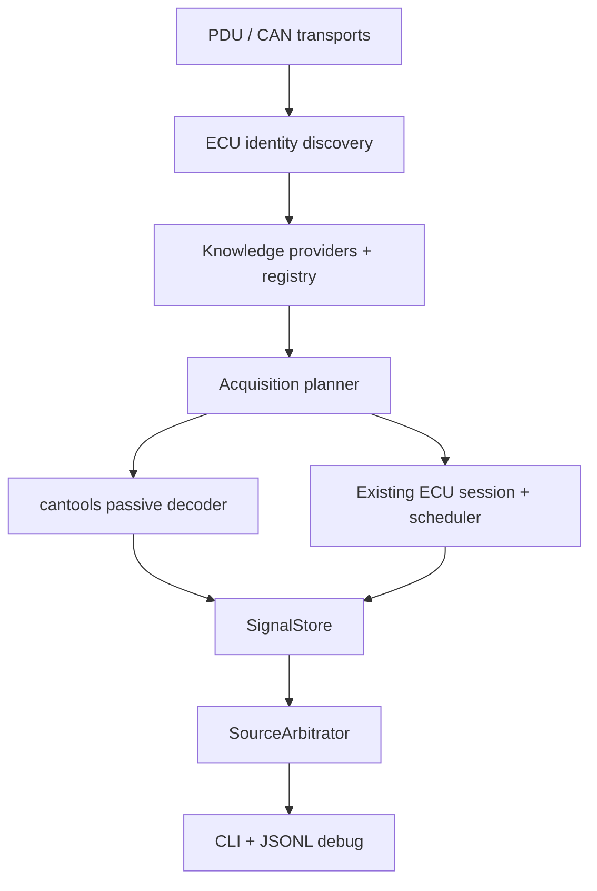

# End-to-end read-only runtime

Status: first integrated PC runtime on `feature/diagnostic-data-import`.

## Implemented path



The orchestrator is `minidash_live.pipeline`. It does not implement a second
transport, UDS client, scheduler, decoder or store. It connects the existing
components.

The runtime accepts canonical names. A request for `engine.rpm` is resolved to
applicable definitions, then to observed passive CAN and/or a UDS `PollJob`.
The caller never supplies a DID or CAN ID for a requested signal.

## Integration audit result

Before this milestone:

* `probe` opened a transport and called `ReadClient` directly;
* driver discovery did not discover ECUs;
* typed identity was not populated from wire reads;
* provider definitions were not converted to scheduler jobs;
* DBC decoding and UDS polling published to the same store only in separate
  unit examples;
* source arbitration was not called by a running acquisition loop.

Now discovery, catalog, planning, acquisition, store and arbitration share one
runtime path. The old bounded `probe` command remains available for research.

## Configuration contract

Runtime configuration is external data. Core contains no Tiguan, CZPA, DQ500,
MQB CAN-ID or VAG DID branch.

Minimal structure:

```json
{
  "vehicle_identity": {
    "manufacturer": "VAG",
    "platform": "MQB"
  },
  "transport": {
    "kind": "socketcan",
    "channel": "can0"
  },
  "ecus": {
    "engine": {
      "txid": "REPLACE_WITH_VERIFIED_TXID",
      "rxid": "REPLACE_WITH_VERIFIED_RXID",
      "bitrate": 500000,
      "address_evidence": "trace/file/reference",
      "identity_probes": [
        {"did": "F190", "target": "vehicle.vin", "encoding": "ascii"}
      ]
    }
  },
  "passive_can": {
    "interface": "socketcan",
    "channel": "can0",
    "bitrate": 500000
  },
  "dbc_databases": {
    "opendbc/vw_mqb": "/absolute/path/to/vw_mqb.dbc"
  },
  "poll_periods": {
    "engine.coolant_temperature": 1.0
  },
  "poll_cooldown": 0.05
}
```

Do not paste illustrative addresses from documentation into a vehicle config.
The runtime does not scan functional `0x7DF` and does not guess physical
addresses. Each endpoint requires `address_evidence`.

`F190`/VIN is the only generic default identity probe. Additional part,
software, hardware and ASAM probes are configured only after their raw DID
layout is evidenced for the target environment:

```json
{"did": "F187", "target": "ecu.part_number", "encoding": "ascii"}
```

This line documents configuration syntax; it is not a claim that every VAG ECU
returns a plain ASCII part number from `F187`.

Configuration identity fields are expectations, not observed facts. Registry
selectors become available only after the corresponding probe succeeds. A
negative response records an error and leaves the field absent. A timeout makes
that endpoint unavailable but does not discard other detected ECUs.

## Discovery and fingerprint

```bash
python -m minidash_live discover \
  --config ./tiguan-read-only.json \
  --output ./artifacts/tiguan-identity.json \
  --debug
```

Discovery opens only configured physical endpoints, performs allowlisted
`ReadDataByIdentifier` calls, and produces `VehicleIdentity`, `EcuIdentity` and
one `IdentityContext` per detected ECU.

The fingerprint is a canonical `ecu-v1:` JSON key with sorted field names.
Missing fields are omitted. It is deterministic and readable; it is not a
security hash and missing fields never act as wildcards.

## Applicable signal catalog

```bash
python -m minidash_live signals \
  --config ./tiguan-read-only.json \
  --identity-snapshot ./artifacts/tiguan-identity.json \
  --all-implementations
```

Filters:

```bash
python -m minidash_live signals --config ./tiguan-read-only.json \
  --identity-snapshot ./artifacts/tiguan-identity.json --ecu engine --source can
```

The catalog reports every applicable implementation, provider, route,
provenance, confidence, applicability, unit, TTL, expected period, raw-decoder
availability and runtime source availability. A definition loaded from a DBC is
`known`, not `available`; CAN becomes available only after its frame is seen.

The VAG provider now exposes the existing exact ECU profile DID/name
associations as knowledge definitions. Most have no evidenced raw codec and are
therefore visible/readable as raw data but do not invent a numeric value.

## Planning and runtime availability

The planner keeps passive definitions subscribed. It creates UDS jobs only when:

* a definition is proven applicable to discovered identity;
* the logical ECU was detected;
* an explicit/definition expected polling period exists.

If usable CAN is live, the corresponding UDS job is disabled. When CAN reaches
TTL and becomes stale, the UDS job is re-enabled. NRC `0x31` permanently blocks
that job for the run, preventing a retry storm.

Source states are `known`, `available`, `stale` and `unavailable`. Availability
is runtime state and never changes provenance or applicability.

## Watch

```bash
python -m minidash_live watch \
  --config ./tiguan-read-only.json \
  --identity-snapshot ./artifacts/tiguan-identity.json \
  --duration 30 \
  --interval 1 \
  --trace ./artifacts/tiguan-watch.jsonl \
  engine.rpm engine.coolant_temperature vehicle.speed
```

Use `--json` for complete store rows, arbitration decisions, availability and
metrics. Text output shows selected value, unit, source, quality and age.

The JSONL trace connects:

* PDU TX/RX;
* discovery result;
* matched catalog and plan;
* CAN source observation;
* UDS acquisition result and latency;
* arbitration selection/switch;
* final store/metrics summary.

Raw CAN frames are not logged by default.

## Read-only boundary

`ReadClient` accepts only:

* `0x22` ReadDataByIdentifier;
* `0x10 01` default session;
* explicitly enabled `0x10 03` extended session;
* `0x3E 00` TesterPresent.

ECU reset, SecurityAccess, WriteDataByIdentifier, RoutineControl, coding,
adaptation, flashing and ClearDTC are rejected before transport send. Runtime
planner jobs additionally require reconnect identity verification; if it fails,
the signal DID is not transmitted.

## Offline proof

`tests/test_pipeline.py` uses real `python-can` VirtualBus, `can-isotp`, the
production `CanTransport`, `ReadClient`, `EcuSession`, `Scheduler`, cantools
`DbcAdapter`, `SignalStore` and `SourceArbitrator`.

It verifies:

1. identity RDID discovery;
2. deterministic fingerprint;
3. provider-style canonical definitions;
4. production UDS polling and decoding;
5. production DBC passive decoding;
6. passive CAN selection;
7. CAN TTL expiry;
8. automatic UDS fallback;
9. no UDS job for an unknown ECU variant.

Synthetic bytes prove wiring only and are not vehicle validation evidence.

## First Tiguan read-only run

Reference vehicle: VW Tiguan II 2017, MQB, CZPA, DQ500, 4Motion.

1. Connect a battery support unit if the session may be long. Ignition ON;
   begin with engine OFF. Close ODIS and every other diagnostic tester.
2. For VNCI/J2534, inventory the driver first:

   ```powershell
   python -m minidash_live doctor --output .\artifacts\vnci-driver.json
   ```

3. Record verified physical addressing and create a local
   `tiguan-read-only.json`. Do not commit DLL paths, VIN or unredacted traces.
4. Run discovery and keep the complete output:

   ```powershell
   python -m minidash_live discover --config .\tiguan-read-only.json `
     --output .\artifacts\tiguan-identity.json --debug
   ```

5. Review applicable knowledge before sending measurement requests:

   ```powershell
   python -m minidash_live signals --config .\tiguan-read-only.json `
     --identity-snapshot .\artifacts\tiguan-identity.json --all-implementations
   ```

6. With a SocketCAN/python-can capable interface, first observe passive values:

   ```powershell
   python -m minidash_live watch --config .\tiguan-read-only.json `
     --identity-snapshot .\artifacts\tiguan-identity.json --duration 30 --json `
     --trace .\artifacts\tiguan-passive.jsonl engine.rpm vehicle.speed
   ```

7. Only after identity selectors and a conservative polling period are reviewed,
   add one known RDID-backed canonical signal:

   ```powershell
   python -m minidash_live watch --config .\tiguan-read-only.json `
     --identity-snapshot .\artifacts\tiguan-identity.json --duration 30 --json `
     --trace .\artifacts\tiguan-engine-read.jsonl engine.coolant_temperature
   ```

Generic J2534 supplies complete diagnostic PDUs but the current generic adapter
does not expose a simultaneous raw passive-CAN stream. Passive DBC watch
therefore currently requires a python-can/SocketCAN-capable backend. UDS-only
discovery/watch remains available through J2534.

Bring back:

* `vnci-driver.json`;
* local config with secrets/paths removed;
* `tiguan-identity.json` with VIN redacted in the copy;
* `tiguan-passive.jsonl` and `tiguan-engine-read.jsonl`;
* adapter/backend and ignition/engine state;
* any NRC, timeout and unavailable-source records;
* metrics summary, especially frames decoded, poll latency and source switches;
* an ODIS comparison recorded separately for any value proposed for validation.

Original captures containing VIN are immutable local evidence. Commit only a
redacted derivative with provenance and an explicit statement of transformation.

## Remaining limitations

* Physical VNCI/J2534 and SocketCAN behavior is not yet vehicle-tested.
* Exact raw identity layouts beyond VIN require captured evidence.
* Most exact Tiguan ECU profile signals have DID/name evidence but no raw codec.
* openDBC may describe frames hidden by the OBD gateway.
* Poll periods are explicit; there is no bus-budget optimizer.
* The cooperative scheduler can wait for one ECU up to its bounded timeout.
* No automatic DBC download is performed and no proprietary ODIS database is
  committed.
