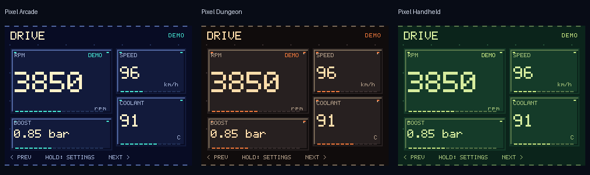

# MiniDash Pixel Pack — 19 октября 2026

Дополнительное оформление существующего MiniDash: **Pixel Arcade**, **Pixel
Dungeon**, **Pixel Handheld**. Это три новые темы общего LVGL renderer, а не
отдельная прошивка с другим диагностическим движком. Старые темы 0–10,
layouts, экраны и пользовательские данные сохраняются. Продолжена изолированная
ветка `feature/hardware-cyd-esp32` от CYD commit `d7f9e92`; main/integration не
сливаются и не перезаписываются.



## Выбор и внешний вид

Settings → Theme: новые темы добавлены в конец списка. В русском интерфейсе
названия сокращены до «Аркада», «Подземелье», «Портативная», чтобы они помещались
в строку настроек. Web Configurator показывает развёрнутые названия и сохраняет
те же theme IDs через существующий API.

| Тема | ID | Графика | Переход |
|---|---:|---|---|
| Pixel Arcade | 11 | Тёмный индиго, бирюзовые блоки, кремовые цифры | Очистка шести блочных рядов |
| Pixel Dungeon | 12 | Тёмные панели, металлическая фаска, оранжевые акценты | Падающие неровные колонны |
| Pixel Handheld | 13 | Тёмно-зелёный фон, светлая LCD-палитра | Мозаичное раскрытие |

«8/16-битный» здесь описывает художественный стиль. Экран остаётся RGB565.
Предупреждения, ошибки и unavailable сохраняют прежний смысл и цвета; неизвестные
измерения не подменяются игровыми очками или нулями. Блочная полоса заполняется
из canonical signal range для числового виджета, из настроенного widget range
для шкалы/графика; при отсутствии значения она пустая.
Новые темы работают с существующими диагностическими и custom layouts, BAR,
STATUS и GRAPH виджетами. Их палитры остаются тёмными и в DAY, как другие
ретро-темы проекта. Wi-Fi по-прежнему включается только вручную в Settings. Поля значений
подбирают меньший pixel font при нехватке ширины, сохраняя само число и единицы;
Settings использует компактный pixel body, чтобы длинные названия помещались.
В обычной числовой карточке достаточного размера единицы отделены от крупных
цифр; маленькие карточки, шкалы и графики сохраняют inline units. При возврате
к старой теме восстанавливается прежнее оформление значений.

## Шрифт и архитектура

- `ui_pixel_art.c/.h`: исходные целочисленные примитивы рамок, фона и переходов;
  callback прямоугольников используется LVGL и native preview harness.
- `ui_font_pixel.c`: собственный 5×7 ASCII atlas, 1 bpp, только целочисленное
  масштабирование. Семь размеров 10/12/14/16/20/28/48, различимые lowercase и
  uppercase (важно для SSID/password). Кириллица, знак градуса и прочий Unicode
  используют уже имеющиеся JetBrains Mono fallback fonts и их OFL-лицензию.
- `tools/generate_pixel_font.py`: воспроизводит C font без внешних ассетов или
  сторонних font downloads. Generated output проверяется тестом.
- `ui_screens.c`: общий выбор шрифтов, украшения карточек и один LVGL timer;
  прежние builders и модели значений переиспользуются.
- `ui_theme.c`, `ui_core.h`: theme IDs добавлены в конец, не перенумерованы.
  NVS/JSON schema остаётся 4; дополнительные style metadata не меняют config.
- `webui.html`: тот же редактор с pixel preview. Исправлен shorthand background,
  который в браузере сбрасывал backgroundImage старых scanline-тем: цвет теперь
  задаётся через backgroundColor.
- `tools/preview_pixel_pack.py` и `core/test_pixel_art.c --preview`: PNG/GIF/HTML
  showcase из тех же C-примитивов и atlas. Значения — fixture; текстовое размещение
  preview иллюстративное, это не LCD screenshot и не новый vehicle simulator.

У процедурных переходов нет malloc/canvas/копии старого кадра. Они используют
не более 48 прямоугольников и один timer с периодом 32 ms. CYD сохраняет один
DMA buffer 320×16 и единственную текущую LVGL-сцену, без PSRAM. LVGL draw tasks
и font cache всё равно расходуют RAM; отсутствие framebuffer не означает нулевой
расход памяти. Номинальная длительность — 320 ms, Dungeon — 420 ms; реальный
момент завершения зависит от отрисовки и SPI, это не гарантия FPS.

Переходы opt-in: только у трёх новых тем, на смене экрана или темы. При повторном
вызове show того же экрана эффект не перезапускается. Быстрая навигация начинает
новый переход без очереди кадров. Timer хранит состояние, а не указатель на
удаляемую сцену CYD; после завершения он приостановлен. Touch/input и источник
сигналов не блокируются ожиданием эффекта. QR и calibration экраны обходятся без
переходов. Прежняя CRT startup sequence не заменена; первый show на boot не
запускает дополнительный wipe поверх неё.

## Проверки

Полный offline gate: **PASS**, 229 Python tests (1 Windows AF_CAN skip),
**12/12 CTest**, Web fake-DOM, JSON/editor roundtrip, VirtualBus, analytics replay.
Новый C test перебирает progress 0..1000, landscape/portrait и малые размеры:
все прямоугольники внутри bounds, начальное полное покрытие, монотонное
раскрытие, отсутствие покрытия в конце; старые темы не рисуют pixel effects.
Web test сохраняет ожидания старых ID/стилей и проверяет все три новые темы,
Preview/Cancel, bevel/monospace/pixelated styling. Font tests проверяют 95 glyphs,
различимость регистра и воспроизводимость generated C.

ESP-IDF 5.5.5 / GCC 14.2.0: CYD `cyd-0.2.0-pixel` и отдельный regression build
ESP32-S3 PASS. Исходные S3 sdkconfig/partitions/lock не изменены. Физический S3
в этом сеансе не прошивался.

Предварительный COM4 прогон: 8/8 hardware self-tests, 27/27 UI core и actual LVGL
view test PASS; все 95 ASCII glyphs в семи размерах и кириллица через fallback
найдены LVGL. Pixel Arcade navigation запускает/завершает draw callbacks, DEMO
RPM/speed продолжают меняться. Номинальные 320 ms завершались примерно за
415–450 ms на этой плате. Число DRAW_POST callbacks не является измерением FPS.

Финальный аппаратный прогон (`pixel-hardware-final.log`): **PASS**.
8/8 hardware, 27/27 UI, actual LVGL view, 95 ASCII × 7 sizes + Cyrillic fallback,
подбор font для wide/compact/units/Settings, завершённые переходы всех трёх тем.
**66/66 HTTP tests PASS**: 14 тем, 8 layouts, 4 rotations, Preview/Save/Cancel,
revision/local takeover, DNS/captive redirect, NVS и сохранение calibration blob.
Тест-клиент работает на ESP32; это не внешний телефонный тест.

Финальный 120-second navigation/DEMO soak: heap samples
`132480, 132480, 132480, 132468, 132468, 133748, 135660` bytes;
нет reset/WDT/assert, данные продолжают меняться. Рост свободной памяти
соответствует освобождению сетевых ресурсов после выключения AP; короткий
прогон не является доказательством отсутствия любых утечек.
Минимум тяжёлого совместного HTTP прогона — **6912 bytes**, stack spare HTTP
2576 bytes, selftest 2332 bytes. До этого RC выдержал 5-minute navigation soak
(16 samples, 132416–135664 bytes), также без WDT/assert.

После reboot и read-only проверки установочного скрипта плата оставлена:
**theme=11 Pixel Arcade, brightness=70%, screen=0, display=1, touch=1,
Wi-Fi=0**, DEMO RPM/speed доступны. Theme 11 сохраняется через reboot.
`Update-Pixel.ps1 -ValidateOnly`: SHA256 original backup/app и MAC платы PASS,
без записи flash; отдельные команды загрузки app реально выполнены с проверкой
hash. Полный install/restore PowerShell проверен синтаксически; исходный
NerdMiner повторно не восстанавливался поверх работающего MiniDash.

## Сборка и возврат

Сборка через прежний `python tools/build_firmware.py minidash_cyd`; S3 через
`python tools/build_firmware.py esp32_s3`. Для native preview включить CTest,
собрать `minidash-pixel-tests` и запустить (Pillow 12.3.0 использован при поставке):

```powershell
python tools/preview_pixel_pack.py --harness core/build-cyd-check/minidash-pixel-tests.exe --output artifacts/local/pixel-preview
```

Для возврата к классическому оформлению выбрать любую прежнюю тему, например
OEM. Возврат не требует перепрошивки. Перед downgrade к CYD 0.1 сначала выбрать
старую тему: старый бинарник не знает новых ID 11–13 и может отвергнуть сохранённый
config. App-only обновление по адресу 0x10000 сохраняет NVS; полный merged install
по адресу 0 заменяет NVS. В поставке сохранены прежний CYD 0.1 app и проверенный
исходный NerdMiner dump. Процедура восстановления — в [аппаратной инструкции CYD](../hardware/minidash-cyd.md).

## Источники и ограничения

Изучены открытые первоисточники:

- [DOOM main loop / wipe_Melt](https://github.com/id-Software/DOOM/blob/master/linuxdoom-1.10/d_main.c): идея выразительной межэкранной смены сцены.
- [raylib shapes easing box](https://www.raylib.com/examples/shapes/loader.html?name=shapes_easings_box): небольшие процедурные фигуры и поэтапная анимация.
- [LVGL built-in font generator](https://github.com/lvgl/lvgl/blob/master/scripts/built_in_font/generate_all.py): 1-bpp bitmap fonts как штатный способ вывода пиксельного шрифта.

Код и ассеты DOOM/Tetris не копировались; код, atlas, палитры и примитивы написаны
для MiniDash под лицензией проекта MIT. Никакого игрового движка, WAD, изображений
или шрифтов из игр в firmware нет.

В этой ночной сессии LCD не наблюдался камерой/глазами и реальные касания не
выполнялись. Software preview и LVGL draw callbacks не заменяют физическую
проверку читаемости, цветов и пяти точек touch. Следующий приоритет — осмотреть
новые темы на LCD и проверить навигацию пальцем; координаты touch не менялись.
19 октября пользователь подтвердил телефонный тест предыдущего CYD этапа:
«QR подключает, Configurator открывается». Подключение по QR и открытие
Web Configurator физически подтверждены; автоматический captive popup
отдельно не подтверждён. Этот ответ не относится к визуальной приёмке Pixel Pack.
Автомобиль, внешнее питание и CAN не использовались; CAN/UDS на CYD запрещены.
Короткий USB soak не доказывает автомобильную термостабильность или потребление.

При одном повторном прогоне получено 65 PASS / 1 FAIL: все HTTP операции
прошли, но прямое bench-чтение перед NVS roundtrip не получило config mutex
за 200 ms во время асинхронной смены сцены. Внутренний тест теперь ожидает
доступный snapshot с ограниченным числом попыток; rejected writes не
повторяются, результат NVS по-прежнему проверяется. Неподписанный счётчик
ошибки заменён именованным nvs_roundtrip CHECK. Production HTTP API не менялся.
